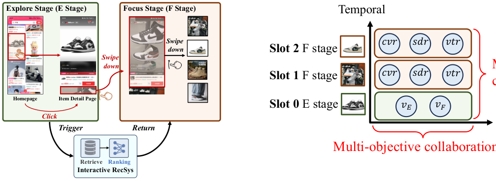
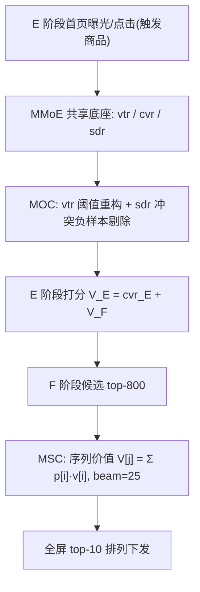
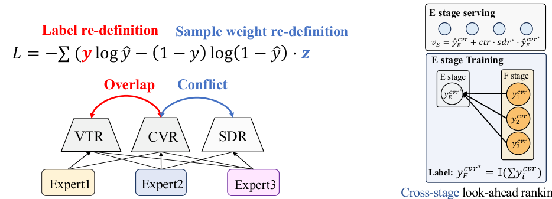

# STCRank: Spatio-temporal Collaborative Ranking for Interactive Recommender System at Kuaishou E-shop (快手电商交互式推荐系统的时空协同排序)

- **会议/期刊**: WWW 2026 (HCRS Workshop, Oral)
- **作者与机构**: Boyang Xia, Ruilin Bao, Hanjun Jiang, Jun Wang, Wenwu Ou（快手科技）
- **推荐链路定位**: 粗排/精排多目标建模 + 列表级重排（E 阶段首页精排与 F 阶段全屏重排联合）
- **研究方向**: 多任务学习与列表级重排 / 去偏公平与工业架构
- **论文原文**: [https://arxiv.org/abs/2601.10027v1](https://arxiv.org/abs/2601.10027v1)
- **开源代码**: 暂未开源

## TL;DR (1分钟核心速览)

快手电商在全屏沉浸式交互推荐（F 阶段，点击首页商品后触发、下滑即切换商品）中发现两个排序系统特有痛点：`view/conversion` 强重叠、`swipe-down/conversion` 强冲突导致多目标融合失效；以及全屏一次只见一个坑位造成的**时序贪心陷阱**。STCRank 用 MOC（重定义 vtr 阈值 25s→5s、剔除"转化后退出"的 sdr 冲突负样本）推进 Pareto 前沿，用 MSC（跨 E/F 阶段看前价值 + beam search 序列重排）求全局最优。无离线数据集，采用 7 天累计线上 A/B：全链路 IPV +9.65%、Purchase +1.55%、DAU +0.03%，F 阶段 DAU 最高 +0.65%。

## Background & Motivation (背景与核心矛盾)

- **主流范式**: 传统电商推荐把 `ctr` 与 `ctcvr` 视为弱相关目标，用 MMoE 加线性加权融合即可；交互式推荐（IRS）则沿用"先探兴趣、再精准推荐"的两段式。
- **前人局限 ①**: 全屏 UI 下用户无需"点击进详情"即可下单，`view` 与 `conversion` 天然高度共现（长时观看先于购买），`swipe-down` 与 `conversion` 天然互斥（买完即退出，61.3% 的转化会话立即退出、74.8% 三屏内退出），常规多目标叠加会互相吞掉或压制。
- **前人局限 ②**: 全屏一次仅暴露 $m$ 个候选中 1 个，槽位严格串行，任一槽位贪婪取局部最优（即时转化）会让"即时转化 = 立刻退出"反复发生，整体会话价值次优。
- **核心洞察 (Key Insight)**: 观看时长 $T$与 `cvr` 的 Spearman 相关性随$T$单调增强（0–2s: 0.0007 → >25s: 0.0822），说明目标重叠度是**阈值可控**的；而 sdr 的失效根源是**标签定义**（每会话$N-1$ 正样本 vs 1 负样本 + 转化即退出的伪负样本），而非模型容量。
- **本文切入点**: 在样本层（标签/权重）消解空间干扰，在排列层（序列价值）消解时间贪心，二者共用一个 MMoE 打分底座。

<figure class="paper-figure" markdown="span">
  <figcaption>图1：我们的交互式电商推荐系统与STCRank框架概览。</figcaption>
</figure>

## Method (核心方法设计)

### 1. 整体框架 (Overall Architecture)

E 阶段首页精排与 F 阶段全屏精排共享一套特征（用户画像、历史行为、目标商品 ID/类目/作者、触发商品属性）与 MMoE 底座，端到端联合训练，输出 `vtr / cvr / sdr` 三目标。E 阶段打分由"即时转化价值 + 看前 F 阶段期望价值"两部分构成，并把高沉浸潜力的高卷入类目（女鞋、女装）优先推到首页，使 E→F 的漏斗更宽；F 阶段先用线性融合打分做 point-wise 粗排（候选 $n=800$），再进入列表级重排：用 beam search（$B=25$）枚举$m=10$ 的排列，按曝光概率折扣后的序列价值选出最优排列下发。两模块在线上以增量 A/B 逐层叠加验证。

### 2. 关键设计拆解 (Key Designs)

1. **MOC：以标签与权重重构消解目标干扰（spatial）**：`vtr` 采用观看时长二值化 $y^{vtr}=\mathbb{I}(T>5)$（基线为$T>25$），把与 `cvr` 的重叠从$\rho=0.0822$段拉回到 0.0068 段，既保留兴趣强度信号又避免目标冗余；`sdr` 只保留首位 PV 样本以提升判别力，并对"已转化后退出"的样本置零权重：$z_i^{sdr}=0$if$y_i^{sdr}=0$and$y_i^{cvr}=1$，否则为 1。直觉是：把"买了才走"从"不想滑"的负样本池里摘出去，sdr 才真正表征"继续浏览意愿"而非"尚未购买"。
2. **MSC 跨阶段看前打分（cross-stage look-ahead）**：E 阶段曝光到 F 阶段转化隔着"点击 + 下滑"两级漏斗，直接回归会标签极度倾斜，故构造聚合标签 $y^{cvr*}_F=\mathbb{I}(\sum_i y_i^{cvr}>0)$并分解为$V_F[c]=ctr[c]\cdot sdr^{*}[c]\cdot\hat{y}^{cvr*}_F[c]$，最终排序分为$V_E[c]=\hat{y}^{cvr}_E[c]+V_F[c]$，即在即时转化等价的候选间优先选"能撑起后续沉浸浏览"的商品。
3. **MSC 单阶段序列重排 + 训练/推理开销**：把曝光概率递归分解为连续下滑率乘积 $p[i]=\prod_{k=1}^{i-1}sdr[k]$，从而复用已有的 sdr 预测，序列价值$V[j]=\sum_{i=1}^{m}p[i]\cdot v[i]$，$v[i]=w_1 vtr+w_2 cvr+w_3 sdr$。总损失为加权 BCE$\mathcal{L}(\Theta)=-\sum_{i\in S}\sum_{j=1}^{3}z_i^j\,[y_i^j\log\hat{y}_i^j+(1-y_i^j)\log(1-\hat{y}_i^j)]$；融合权重$w_j$用贝叶斯优化以三目标 AUC 之和为目标在离线搜优。线上重排仅对$m=10$、beam 25 做排列评估，开销可控，无需额外负采样。

<figure class="paper-figure" markdown="span">
  <figcaption>图2：MOC模块与MSC模块概览。</figcaption>
</figure>

## Experimental Setup & Evaluation Protocol (实验设置与评估协议)

- **数据与上线形态**: 本文**未使用公开离线数据集**，全部结论来自快手电商线上真实流量；E 阶段与 F 阶段精排模型端到端联合训练，排序候选 $n=800$、下发$m=10$、beam size$B=25$。

| 线上实验配置 | 规模/口径 | 说明 |
| :--- | :---: | :--- |
| 实验周期 | 固定 7 天 | 每轮新策略 A 对比上一轮全量版本 B |
| 触发机制 | E 阶段点击触发 F 阶段 | F 结果预取于详情页底部，下滑进入 |
| 核心指标 | IPV / Purchase / DAU | F 阶段 IPV 定义为观看 >2s 的有效 PV；E 阶段为真实点击 PV |
| 口径隔离 | IPV(F)、Purchase(F)、DAU(F) | 单模块归因用 F 阶段口径；整体贡献用 E+F 合并口径 |

- **数据划分与防穿越**: 无离线划分，采用**线上增量 A/B（7 天累计、上一版全量做基线）**，天然规避训练/评估穿越，但也丧失离线可复现性。
- **排名评测协议**: 线上真实曝光排序（相当于全库漏斗下的**全库排序**，非采样排序），指标为业务口径的 IPV/Purchase/DAU 相对提升，未报告显著性 $p$ 值。
- **对比基线与超参**: 基线为"单目标 → 多目标基线 → 逐层消融"的自身历史版本；`vtr` 阈值扫描 $\{2s, 5s, 25s\}$；融合权重由贝叶斯优化搜索。

## Key Experimental Results (实验关键数据)

### 1. 主实验对比 (Main Results)

线上增量 A/B（每行基线为该行所标注的上一版本，"+"为相对提升）：

| 实验版本 | 相对上一版的改动 | IPV(F) | Purchase(F) | DAU(F) |
| :--- | :--- | :---: | :---: | :---: |
| MOC-base | 单目标 → 加入 vtr 目标（25s 标签） | **+6.96%** | +0.53% | +0.27% |
| MOC-1 | vtr 标签阈值 25s → 5s（降重叠） | +4.87% | +1.90% | +0.15% |
| MOC-2 | 加入 sdr 并优化其与 cvr 冲突 | +3.60% | +0.42% | +0.12% |
| MOC-3 | 三目标 Pareto 超参贝叶斯寻优 | +1.21% | +4.18% | +0.12% |
| MSC-1 | F 阶段内多槽位 look-ahead 重排 | +1.94% | +2.10% | +0.41% |
| MSC-2 | 跨 E/F 阶段 look-ahead 打分 | +0.60% | **+2.66%** | **+0.65%** |
| **STCRank 整体** | MOC-base → 完整框架（E+F 口径） | **+9.65%** | **+1.55%** | **+0.03%** |

### 2. 消融实验 (Ablation Study)

| 消融设置 | 改动 | IPV 提升 | Purchase 提升 |
| :--- | :--- | :---: | :---: |
| SDR-1 | 直接加入 sdr（无任何处理） | +0.51% | **-3.22%** |
| SDR-2 | + 首位 PV 样本筛选 | +2.90% | **-5.95%** |
| SDR-3 | + 转化后退出样本权重置零 | +3.60% | +0.42% |
| VTR(>25s) | 基线阈值 | — | — |
| VTR(>5s) | 本文阈值 | +4.87% | +1.90% |
| VTR(>2s) | 更低阈值 | +8.99% | -0.49% |

### 3. 关键实验发现 (Key Findings)

1. **sdr 的负向伤害完全来自标签冲突而非模型**：SDR-1 直接加入 sdr 使购买 −3.22%，首位筛选（SDR-2）甚至恶化到 −5.95%，仅当剔除"转化后退出"样本（SDR-3）后 IPV 立刻 +3.60% 且购买转正，证明该冲突是最关键的因果开关。
2. **vtr 阈值是"参与度 vs 转化"的显式旋钮**：2s 阈值把 IPV 拉到 +8.99% 却让购买 −0.49%，25s 阈值重叠过重，5s 是唯一使 IPV 与 Purchase **同时正增益**的折中点。
3. **重排收益几乎全部来自"换序"而非"换集合"**：新排列与原 point-wise 结果的 Hit@All(10)=89.6%（集合差异可忽略），但 Hit@1 仅 30.9%，说明增益源于前几位顺序调整；类目上女鞋 +42.0%、女装 +25.2% 远高于配饰 +12.6%，会话深度整体 +7.2%（女鞋 +32.6%），即模型把"高卷入品类需要多看多比"的浏览需求显式兑现。

## Highlights & Limitations (亮点、对比与审稿批判)

- **与代表作对比**: 相比 MMoE/PLE 类多任务精排只用 loss 加权或门控缓解负迁移，本文从**标签定义域**下手（阈值重设 + 冲突样本零权重），比结构改造更轻、更可解释；相比 DLCM/PRS 等 listwise 重排依赖单独训练的曝光/级联模型，本文把曝光概率递归分解为已建模的 $sdr$ 乘积，**零额外模型**即可做序列评估；相比 TIRS（显式问答）/EIRS（单条替换）两类 IRS，本文支持连续多槽位全屏沉浸流。
- **可迁移亮点**: ①"目标对的相关系数随分桶变量变化"这一诊断流程（如表 1 的 Spearman 扫描）可直接用于任何多目标阈值选择；②把 session-level 序列价值写成 $\sum_i \prod_{k<i}sdr[k]\cdot v[i]$，让重排复用召回/精排已有概率输出，工程上极易落地。
- **审稿级局限批判**: ①**全程无离线数据集与公开基线**，只有自比自的增量 A/B，且"每行以上一版为基线"使各模块增益不可加总，MSC-2 的 IPV 仅 +0.60% 也缺乏显著性检验，方法优越性难以被第三方复现验证；②跨阶段 look-ahead 需要 E/F 两阶段标签打通与预取，F 阶段结果在用户未下滑时被浪费，且 beam=25 的排列评估在候选量级放大后存在延迟与超参（beam、$w_j$）敏感问题，论文未给出时延/QPS 与权重稳定性分析。

## Rating (四维评分)

- **方法创新性 (Novelty)**: ⭐⭐⭐⭐ （"标签域消解目标干扰 + sdr 链式乘积做序列价值"思路新颖且物理直觉清晰，但整体仍是 MMoE + listwise 重排的工程化组合）
- **评估协议与实验扎实度 (Protocol & Experiments)**: ⭐⭐⭐ （线上 7 天全量 A/B 与逐层消融有说服力，但无离线基准、无显著性检验、增益不可加总，可复现性弱）
- **写作与数学规范度 (Clarity & Rigor)**: ⭐⭐⭐⭐ （问题刻画与三项公式干净利落，冲突/重叠的定量表格到位；但符号在 Eq.8–10 处对 $V_E$ 的定义略含混，缺复杂度分析）
- **工业落地与复现价值 (Industrial & Practical Value)**: ⭐⭐⭐⭐⭐ （已在快手电商 2025.6 全量上线，带来购买与 DAU 共增长，改造点少、复用现有 sdr 输出，落地价值极高；但代码未开源）

