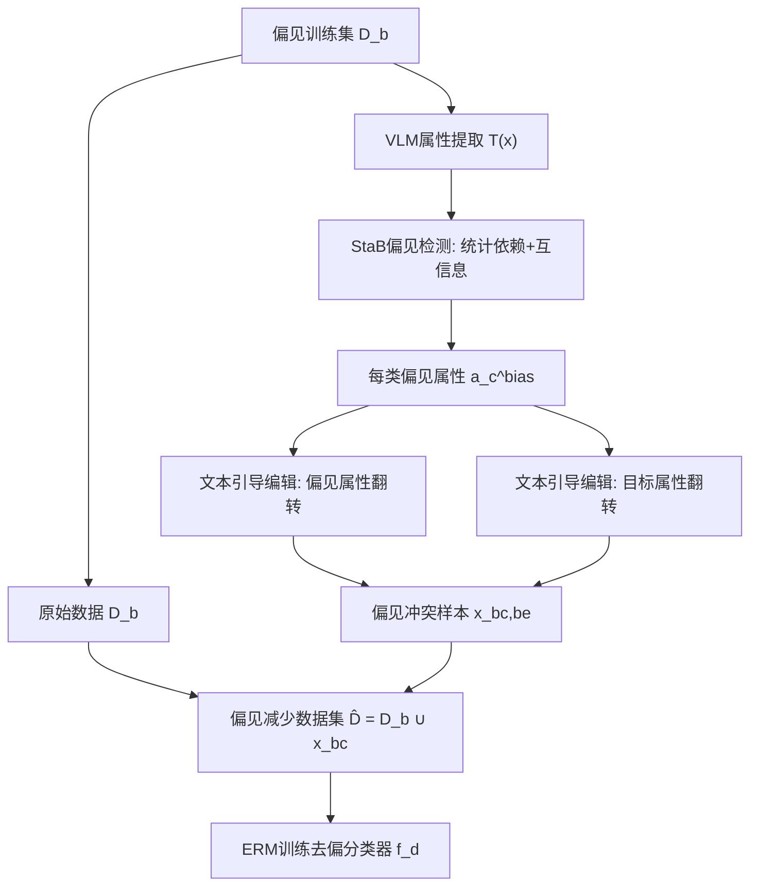
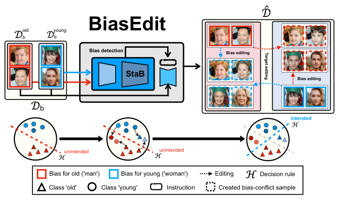

# BiasEdit: A Training-Free Bias-Detect-and-Edit Framework for Learning Fair Visual Classifiers (BiasEdit：一种无需训练的偏见检测与编辑框架，用于学习公平的视觉分类器)

- **会议/期刊**: The Web Conference 2026 (WWW '26, Oral)
- **作者与机构**: Jungwook Seo, Yoonsik Park, Changmin Lee, Sungyong Baik (Hanyang University, BAIK Lab)
- **推荐链路定位**: 数据预处理/训练集增强（上游数据去偏，服务于下游推荐与内容审核）
- **研究方向**: 多模态推荐 / 去偏公平与可信
- **论文原文**: [https://arxiv.org/abs/2605.28450v1](https://arxiv.org/abs/2605.28450v1)
- **开源代码**: 暂未开源

## TL;DR (1分钟核心速览)

Web采集的视觉数据隐含虚假关联（如“女性-年轻”“水鸟-水域”），使下游分类器学到偏见属性而非目标特征。针对现有方法依赖已知偏见标注、或仅能做样本混合/对抗扰动而生成样本失真的痛点，BiasEdit 提出**无需训练**的两阶段框架：先用视觉-语言模型提取属性关键词，以统计依赖+互信息双重条件检测每类未知偏见属性；再用文本引导图像编辑生成真实的“偏见冲突样本”扩充训练集。在Colored MNIST、BFFHQ、Dogs & Cats、Waterbirds四个基准的**100%偏见训练集**极端设置下，BC精度分别达91.28%、62.46%、59.04%、58.28%，全面超越8个SOTA去偏基线。

## Background & Motivation (背景与核心矛盾)

- **主流范式**: 去偏分类的主流做法是识别“偏见冲突样本”（bias-conflict）并对其加权，或通过mixup/对抗攻击/特征空间增广来扩充冲突样本，以缓解偏见对齐样本的压倒性多数。
- **前人局限**: ①早期方法假设所有偏见属性已知，依赖昂贵的人工属性标注，难以规模化；②未知偏见下的方法（LfF/BE/SelecMix等）仅通过辅助模型损失或像素级扰动间接处理，生成样本**不够真实**且**保留大量偏见**；③现有评估多只在偏见冲突测试集上报精度，忽视偏见对齐样本的整体泛化。
- **核心洞察 (Key Insight)**: 偏见属性可被“显式”检测与“显式”编辑。VLM能大规模提取图像属性关键词，而偏见属性与类标签之间存在可量化的统计依赖与互信息增益；文本引导编辑可在保留原图其他属性的前提下精准翻转偏见或目标属性，从而生成分布内的高质量冲突样本。
- **本文切入点**: 把“去偏”转化为“数据编辑”问题——先检测、再编辑、后训练，全程**无需额外训练生成模型**，也**无需偏见属性标注**。

## Method (核心方法设计)

### 1. 整体框架 (Overall Architecture)

BiasEdit 是一条“检测→编辑→重训”的模块化流水线。输入为完全偏见的训练集 $\mathcal{D}_b=\{(\boldsymbol{x}_i,y_i)\}_{i=1}^N$。首先用 VLM 对每张图提取属性关键词集合$T(\boldsymbol{x})$，聚合得到每类属性池$\mathcal{A}_c$；StaB 模块对池中每个属性依次计算统计依赖（Condition 1）与互信息（Condition 2），为每个类选出唯一偏见属性$a_c^{\text{bias}}$。然后以检测结果为提示词，调用预训练文本引导编辑模型，对原图分别执行**偏见编辑**（翻转偏见属性）和**目标编辑**（翻转目标类别属性），生成两类偏见冲突样本。最终将原数据与编辑样本合并为偏见减少数据集$\hat{\mathcal{D}}=\mathcal{D}_b\cup\{\tilde{\boldsymbol{x}}_{bc}\}$，在其上以标准 ERM 训练去偏分类器$f_d$。因编辑模型与 VLM 均 off-the-shelf，整个流程**零训练开销**。

<figure class="paper-figure" markdown="span">
  <figcaption>图1：BiasEdit 流程示意图。BiasEdit 首先检测未知偏见。然后，利用检测到的偏见，通过编辑偏见属性和目标属性生成偏见冲突样本，从而缓解数据集偏见。</figcaption>
</figure>

### 2. 关键设计拆解 (Key Designs)

1. **StaB 统计偏见检测器（双条件筛选）**：仅用统计依赖会让“雪景”这类稀有属性误判为偏见（类条件概率高但信息量低），仅用互信息又忽略类级别熵减。StaB 先以 Condition 1 筛出候选集 $\mathcal{A}_c^{dp}=\{a\in\mathcal{A}_c:\mathbb{P}_{dp}=1\}$，其中$\mathbb{P}_{dp}:=\mathbb{I}\big(P(Z_c=1|W_a=1)>P(Z_c=1)\big)$，$Z_c=\mathbb{I}(Y=c)$、$W_a=\mathbb{I}(a\in T(X))$；再在候选集上取互信息最大者：
$$a_c^{\text{bias}}=\arg\max_{a\in\mathcal{A}_c^{dp}} MI(Z_c;W_a)=H(Z_c)-H(Z_c|W_a).$$
物理直觉：依赖条件保证属性分布向该类倾斜，互信息保证该属性确实大幅降低类不确定性，二者交集才能锁定“易学且虚假”的捷径特征。

2. **偏见/目标双路编辑生成冲突样本**：现有生成式增广（mixup、对抗扰动、T2I 直接生成）要么不真实、要么丢失原图难以言表的细节（姿态、视角）。BiasEdit 改用编辑算子：
$$\tilde{\boldsymbol{x}}_{bc,be}^{c}=\text{ImageEditing}(\boldsymbol{x}^c,I_{be}^{c}),\quad \tilde{\boldsymbol{x}}_{bc,te}^{m}=\text{ImageEditing}(\boldsymbol{x}^c,I_{te}^{c\to m}),$$
其中 $I_{be}^{c}$指示翻转类$c$的偏见属性（如“把这个年轻人变成年轻男人”），$I_{te}^{c\to m}$指示把类$c$样本的目标属性改为类$m$（如“把这个女人变成老女人”）。前者直接为类$c$补充冲突样本，后者通过把$c$样本编辑为$m$类来削弱偏见属性与类$m$ 的虚假关联。由于编辑模型只在必要属性上做局部修改，其余视觉因素被最大程度保留，生成分布更贴近原始数据流形。

3. **训练目标与推理开销**：分类器沿用标准交叉熵 $\mathcal{L}_{\text{CE}}=-\frac{1}{|\hat{\mathcal{D}}|}\sum_{(\boldsymbol{x},y)\in\hat{\mathcal{D}}}\log f_d(y|\boldsymbol{x})$，无额外公平正则、无负采样技巧。偏见检测约需 13 GB GPU 显存，图像编辑合计约 50 GB（单卡 A100 完成），分类器训练可在 RTX 2080Ti 上完成；推理阶段与普通分类器完全一致，**零额外线上开销**。

## Experimental Setup & Evaluation Protocol (实验设置与评估协议)

- **数据集与预处理**（四个标准去偏基准，均以 {目标类, 偏见属性} 成对设计）：

| 数据集 | 类别数 | 偏见属性对 | 训练集偏见冲突比例 | 图像尺寸 | 骨干 |
| :--- | :---: | :--- | :---: | :---: | :--- |
| Colored MNIST | 10 | {数字, 颜色} | 0% (主实验) / 1% / 5% | 28×28 | 3层MLP |
| BFFHQ | 2 | {年龄, 性别} | 同上 | 224×224 | ResNet-18 |
| Dogs & Cats | 2 | {动物, 毛色亮度} | 同上 | 224×224 | ResNet-18 |
| Waterbirds | 2 | {鸟种, 背景} | 同上 | 224×224 | ResNet-18 |

- **数据划分与防穿越**: 主实验固定 **0% 偏见冲突比例（即100%偏见训练集）** 为最严苛设置；从训练集随机采样 20% 作为**分布内验证集**用于模型选择，测试集同时报告偏见冲突（BC）与偏见对齐（BA）两个子集。
- **排名评测协议**: 分类精度，非检索排序；对比两套模型选择协议——(a) 按分布内验证集最优选择（实用协议，主表）；(b) 按偏见冲突测试集最优选择（沿用前人协议，附表对照）。
- **对比基线与超参设置**: 8 个无需偏见标注的基线：Vanilla、LfF、LfF+BE、SoftCon、DeNetDM、DFA、SelecMix、BiasAdv。所有基线共享相同训练设置，BiasEdit 仅改变训练集构成；学习率 CMNIST 为 0.01，其余为 0.0001；图像标准化采用 ImageNet 均值/方差；结果取 3 次运行平均。

## Key Experimental Results (实验关键数据)

### 1. 主实验对比 (Main Results)

下表为 **100% 偏见训练集**、按分布内验证集选择模型时的测试精度（%），BC/BA/Avg 分别对应偏见冲突、偏见对齐与总体均值：

| 方法 | CMNIST BC | CMNIST Avg | BFFHQ BC | BFFHQ Avg | D&C BC | D&C Avg | Waterbirds BC | Waterbirds Avg |
| :--- | :---: | :---: | :---: | :---: | :---: | :---: | :---: | :---: |
| Vanilla | 0.56 | 50.26 | 37.96 | 68.64 | 20.03 | 58.67 | 21.74 | 58.42 |
| LfF | 1.13 | 50.55 | 39.52 | 68.70 | 30.35 | 56.90 | 39.91 | 61.69 |
| LfF+BE | 0.66 | 50.33 | 34.20 | 62.37 | 40.12 | 55.87 | 63.11 | 55.74 |
| SoftCon | 0.12 | 50.06 | 39.40 | 69.35 | 23.63 | 60.72 | 25.68 | 60.32 |
| DeNetDM | 0.01 | 50.00 | 49.13 | 74.10 | 17.04 | 56.21 | 21.70 | 58.24 |
| DFA | 0.81 | 50.40 | 35.12 | 66.54 | 23.81 | 57.29 | 37.95 | 64.22 |
| SelecMix | 2.22 | 51.08 | 39.20 | 65.70 | 32.38 | 52.34 | 54.66 | 69.44 |
| BiasAdv | 2.88 | 51.43 | 40.66 | 69.86 | 15.41 | 55.27 | 23.59 | 58.81 |
| **BiasEdit (ours)** | **91.28** | **93.95** | **62.46** | **80.70** | **59.04** | **77.98** | **58.28** | **74.88** |
| **Improv. (Avg vs 最优基线)** | — | **+82.52** | — | **+6.60** | — | **+17.26** | — | **+5.44** |

### 2. 消融实验 (Ablation Study)

| 消融设置 | CMNIST Avg | BFFHQ Avg | D&C Avg | Waterbirds Avg |
| :--- | :---: | :---: | :---: | :---: |
| 原始 $\mathcal{D}_b$（无编辑） | 50.26 | 68.64 | 58.67 | 58.42 |
| 仅偏见编辑 $\hat{\mathcal{D}}_{bc,be}$ | 94.40 | 78.93 | 73.38 | 66.87 |
| 仅目标编辑 $\hat{\mathcal{D}}_{bc,te}$ | 63.10 | 75.46 | 68.97 | 72.02 |
| 双路编辑（完整 BiasEdit） | **93.95** | **80.70** | **77.98** | **74.88** |
| 等量采样 $\hat{\mathcal{D}}_{\text{sampled}}$（与$\mathcal{D}_b$ 同大小） | 92.70 | 80.33 | 73.10 | 74.07 |
| StaB 仅用 Condition 1 | 选到‘apple’/‘stick’等稀有属性 | — | — | — |
| StaB 仅用 Condition 2 | 选到‘pink’/‘man’/‘water’等类内高频但非偏见属性 | — | — | — |
| 用 T2I 生成替代编辑 $\hat{\mathcal{D}}_g$ | 69.05 | 62.02 | 61.79 | 62.02 |

### 3. 关键实验发现 (Key Findings)

- **极端偏见场景下的断层式提升**：在 100% 偏见对齐训练集上，所有基线在 CMNIST 的 BC 精度均低于 3%（接近随机），而 BiasEdit 达到 91.28%，Avg 提升 82.52 个点——说明“显式检测+编辑”能在原训练集完全缺少冲突样本时凭空构造出有效监督信号，这是重加权/混合类方法做不到的。
- **编辑而非生成才是关键**：将同一编辑指令交给 T2I 生成模型（$\hat{\mathcal{D}}_g$），BFFHQ 精度反降至 62.02%（低于原始 68.64%），而编辑版达 80.70%。这证明保留原图难以言表的分布细节（姿态、视角、光照）比“生成一张新图”更重要，编辑算子只改必要属性、其余像素尽量不动，才使冲突样本落在原数据流形上。
- **双路编辑互补且数据集大小非主因**：仅用偏见编辑在 CMNIST 上已很强（94.40%），但在 Waterbirds 上弱于目标编辑（66.87% vs 72.02%），双路合并后 Waterbirds 升至 74.88%；同时，将扩充后的 $\hat{\mathcal{D}}$ 随机降采样回与原数据同规模，BFFHQ 仅从 80.70% 跌至 80.33%、Waterbirds 仅跌 0.81 个点，说明主要收益来自样本内容的偏见冲突属性，而非单纯的数据量增加。

## Highlights & Limitations (亮点、对比与审稿批判)

- **与代表作对比 (vs. Prior Work)**: 与 LfF/BE 等“重加权+辅助模型”路线不同，BiasEdit 不依赖训练过程中的隐式信号，而是直接在数据层做显式因果干预；与 SelecMix/BiasAdv 等“混合/扰动”路线相比，其编辑样本语义可解释且保留原图分布；与 T2I 生成式增广相比，编辑范式无需训练生成器、不引入新偏见，且生成质量更贴近原始数据。
- **可迁移亮点**: ①“统计依赖筛候选 + 互信息定序”的双条件属性检测器可迁移到推荐系统的**特征级虚假关联发现**（如曝光位置偏见、流行度捷径）；②“文本引导局部编辑 + 原图保留”的数据增广思路可用于多模态推荐中的**跨模态语义对齐增强**与长尾物品内容扩充。
- **审稿级局限批判**: ①偏见检测依赖 VLM 的属性词表覆盖度，对细粒度或无法用语言描述的偏见（如纹理、构图）可能漏检；②编辑模型（50 GB 显存）与 VLM 推理成本高，且编辑质量受提示词模板影响，论文仅给出少量定性示例，缺少对编辑失败率的定量统计；③评估仅在四个受控小规模基准上完成，虽论文主张可扩展至 Web 级数据，但未给出大规模真实推荐/审核场景的线上验证。

## Rating (四维评分)

- **方法创新性 (Novelty)**: ⭐⭐⭐⭐ （将去偏从“损失重加权”转向“数据显式编辑”，双条件 StaB 检测器与双路编辑设计逻辑清晰，但编辑模型与 VLM 均为现成组件，核心 novelty 在流程编排而非新模型架构）
- **评估协议与实验扎实度 (Protocol & Experiments)**: ⭐⭐⭐⭐ （同时报告 BC/BA/Avg 并对比两套模型选择协议，消融覆盖 StaB 条件、编辑类型、数据量与生成 vs 编辑，实验设计完整；但仅 4 个小基准、缺少大规模与多偏见场景的定量结果）
- **写作与数学规范度 (Clarity & Rigor)**: ⭐⭐⭐⭐ （StaB 双条件公式定义清晰、动机与算子对应紧密，算法伪代码完整；部分符号在正文与附录间略有重复，编辑指令模板的构造细节可更透明）
- **工业落地与复现价值 (Industrial & Practical Value)**: ⭐⭐⭐⭐ （全流程 training-free、推理零额外开销，对 Web 内容审核与推荐冷启动数据净化有直接价值；但编辑阶段 50 GB 显存与 VLM 调用成本构成部署门槛，且代码未开源）

