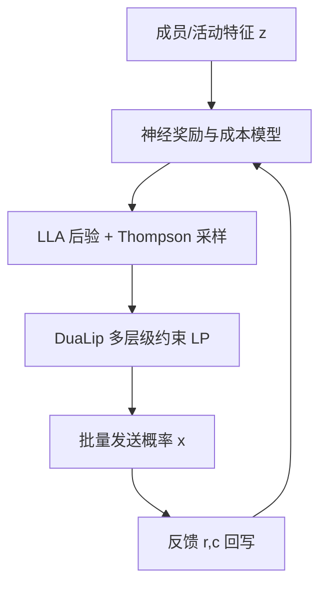
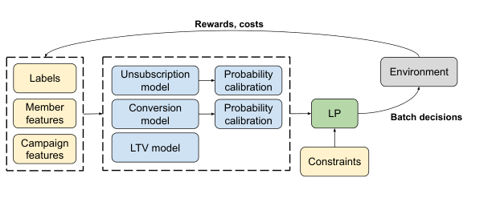

# BanditLP: Large-Scale Stochastic Optimization for Personalized Recommendations (BanditLP：面向个性化推荐的大规模随机优化)

- **会议/期刊**: WWW 2026
- **作者与机构**: Phuc Nguyen、Benjamin Zelditch、Joyce Chen、Rohit Patra、Changshuai Wei，LinkedIn
- **推荐链路定位**: 批量决策/精排式流量分配（邮件营销）
- **研究方向**: 强化学习与动态探索推荐 / 去偏公平与工业架构
- **论文原文**: [https://arxiv.org/abs/2601.15552v1](https://arxiv.org/abs/2601.15552v1)
- **开源代码**: [https://github.com/linkedin/dualip](https://github.com/linkedin/dualip)

## TL;DR (1分钟核心速览)

现有 Contextual Bandit 多优化单一目标，约束型推荐又常缺探索；而工业级“预测模型+LP”方案虽能控约束，却放大选择偏差与“富者愈富”。BanditLP 用神经 Thompson 采样估计奖励/成本分布，再将采样值送入十亿变量级 LP 做多层级约束动作选择。离线合成/OBD 插补实验显示其保持近零约束违反，LinkedIn 七周 A/B 中收入 **+3.08%**、退订率 **-1.51%**。

## Background & Motivation (背景与核心矛盾)

- **主流范式**: 推荐系统用 Contextual Bandit 做探索-利用平衡；工业约束推荐则用监督预测模型配合 LP 做预算、频控、公平性等约束下的批量分配。
- **前人局限**: 线性/多臂 Bandit 难以刻画高维非线性收益与成本；约束 Bandit 多只处理单层级约束，难以覆盖平台、业务线、用户三层约束。
- **第二重矛盾**: 纯 LP 推荐没有探索，模型反复选择已流行物品，形成反馈回路与冷启动偏差；而将概率直接喂给 LP 时，校准不当会扭曲优化。
- **核心洞察 (Key Insight)**: 把“学习不确定收益/成本”与“约束下选动作”解耦：神经 TS 负责表达与探索，LP 负责多利益方约束满足。
- **本文切入点**: 任意神经架构估计 $r,c$，后验采样后求解大规模 LP；并给出校准启发式与探索度监控指标。

## Method (核心方法设计)

### 1. 整体框架 (Overall Architecture)

每周对成员-活动对提取特征 $z_{u,i,t}$，神经模型分别输出转化、退订、LTV 等奖励/成本；对转化与退订施加线性化 Laplace 后验并做 Thompson 采样，将采样值送入 DuaLip 求解多层级约束 LP，得到发送概率$x_{u,i,t}$，再按概率形成批量发送决策；线上反馈回写并增量更新模型，形成“预测-采样-约束优化-反馈”闭环。

<figure class="paper-figure" markdown="span">
  <figcaption>图 1：LinkedIn 基于 BanditLP 的电子邮件营销推荐系统概览。</figcaption>
</figure>

### 2. 关键设计拆解 (Key Designs)

1. **神经 Thompson 采样与 LLA 后验**：解决线性 Bandit 表达力不足。对网络 $f_\theta(z)$在 MAP 权重处线性化，近似后验预测$\mu(z_*)\sim\mathcal{N}(\hat{f}_{\theta_{MAP}}(z_*),\tau V)$，其中$V=\sigma_0^2+g(z_*)^\top\Omega^{-1}g(z_*)$，$g$为最后一层梯度、$\Omega$为 Fisher/Hessian 子矩阵。仅对最后若干层建后验，既保留任意深度架构，又把协方差求逆压到可服务规模；$\tau$ 控制探索强度。
2. **多层级约束 LP 动作选择**：解决多利益方硬约束。每轮求解 $\max_{x}\sum_{u,i}x_{u,i}\hat{r}_{u,i}$，约束包括平台级$\sum_{u,i}x_{u,i}\hat{c}^{(1)}_{u,i}\le C_1$、提供方级$\sum_{u,i\in I_l}x_{u,i}\hat{c}^{(2)}_{u,i}\le C_{2l}$、用户级$\sum_i x_{u,i}\hat{c}^{(3)}_{u,i}\le C_3$及$0\le x_{u,i}\le1$。DuaLip 对$x$加$\gamma/2\|x\|^2$ 扰动转为 QP，仅对不等式做部分拉格朗日对偶，用一阶并行投影求解，可扩展至十亿变量。
3. **校准启发式与探索度监控**：解决“概率进入 LP 后校准反而抑制探索”。先用无探索预测 $\hat{p}$拟合等渗回归$g$，服务时对 TS 采样概率施加$\tilde{p}_{TS}=g(\hat{p}_{TS})$，避免直接用 TS 概率拟合等渗回归造成的过度收缩。再用$\mathrm{Overlap@}K=\frac{1}{N}\sum_n |S_n^{TS}(K)\cap S_n^{exploit}(K)|/K$衡量实际探索度，值越接近 1 探索越少；上线前网格搜索$\tau$ 使 overlap 达安全阈值。
4. **训练目标、负采样与推理效率**：训练侧为监督学习，$\mathcal{L}=\sum \mathrm{BCE}(r,f_r(z))+\sum_k \mathrm{BCE/MSE}(c_k,f_{c_k}(z))$；转化/退订极稀疏且负样本下采样，故事前校准是 LP 可用的关键。探索来自后验采样而非负采样。推理为周级批量 LP，非实时逐请求求解；DuaLip 吞吐与$\gamma$ 共同决定 feasibility 与延迟。

## Experimental Setup & Evaluation Protocol (实验设置与评估协议)

- **数据集与预处理**:

| 数据集 | #Users | #Items | #Interactions | 稀疏度/密度 | 特征/场景说明 |
| :--- | :---: | :---: | :---: | :---: | :--- |
| Synthetic | 未披露 | 未披露 | 按 $T=30$ 轮生成 | 可控 | 随机用户/物品特征，互斥 provider，奖励/成本函数可控 |
| OBD（插补） | 10K 抽样 | 34 | $10K\times34$插补矩阵 | 插补后稠密 | 随机策略子集，二元点击；KNN$K=10$ 填未观测 |
| LinkedIn 在线 | 周度符合资格成员 | campaigns | 7 周 | 工业稀疏 | 邮件营销，B2B/B2C、频控、退订约束 |

- **数据划分与防穿越**: 离线为多轮 Bandit 模拟，初始日志策略有偏（OBD 仅随机曝光 top 30% 物品）；在线采用 **data-diverted** 固定用户分流，实验前只用历史日志训练，实验期两策略仅用各自 cohort 数据更新，防止探索收益泄漏到对照。
- **排名评测协议**: 非传统 top-K 采样排序，而是每轮对全部用户-物品决策变量求解 LP 的**全库批量分配**；指标为累计奖励、全局约束违反量、provider 级违反量。
- **对比基线与超参**: 离线基线为 NNTS（无约束）、LinUCB-LP、NN-LP（监督+LP、无探索）；在线对照为同监督模型+LP 但不做 TS。合成 $T=30,S=50$，OBD$T=50,S=20$；显著性用 Welch$t$检验及零截断非参数检验，$p<0.05$。

## Key Experimental Results (实验关键数据)

### 1. 主实验对比 (Main Results)

离线主实验原文仅设 3 个基线，结果以图 3/4 的累计奖励与约束违反曲线呈现，未给逐点数值，故下表保留定性结论、不臆造数字：

| 方法 | 约束满足 | 累积奖励 | 关键现象 |
| :--- | :---: | :---: | :--- |
| NNTS | 全局/分集均违反 | 最高 | 无 LP，探索强但不可用于多利益方场景 |
| NN-LP | 基本可行 | 较低，早停 | 无探索，陷入选择偏差陷阱 |
| LinUCB-LP | 仍有全局违反 | 较低 | 线性成本模型误设，LP 约束估计失真 |
| **BanditLP** | **近零/低于零** | **高** | 奖励-可行性折中最优 |

在线 A/B（七周，相对提升，95% CI）：

| 指标 | 相对提升 | 显著性 |
| :--- | :---: | :---: |
| Revenue | **+3.08% (+0.17%, +5.99%)** | 显著 |
| Conversion rate | -0.01% (-0.26%, +0.23%) | 不显著 |
| Unsubscription rate | **-1.51% (-2.25%, -0.72%)** | 显著 |

### 2. 消融实验 (Ablation Study)

| 消融/敏感性 | 设置 | 结果 | 归因 |
| :--- | :--- | :--- | :--- |
| 无校准启发式 | 直接对 TS 概率拟合等渗回归 | $\tau$ 增大时校准后分布反而更集中 | 等渗回归收缩噪声，抑制探索 |
| 无 TS（NN-LP） | 监督预测+LP | 可行但长期奖励低 | 选择偏差与冷启动 |
| RQ1 约束敏感性 | 模型质量 $q$与探索$\tau$网格 | 退订相对变化稳定在$\pm2\%$ 内 | LP 约束仍有效绑定 |
| RQ2 分配稳定性 | $\tau$ 增大 | 分配方差上升，高质量模型更敏感 | 低质量模型基线噪声掩盖边际探索 |

### 3. 关键实验发现 (Key Findings)

1. 在线收入 **+3.08%** 而转化率仅 **-0.01%**（不显著）、退订率 **-1.51%**：探索没有带来即时转化增益，却改善了长期收入与用户 guardrail，说明 LP 中的不确定性注入主要在长期价值上生效。
2. 离线 NNTS 奖励最高但全局与 provider 约束均违反；BanditLP 在违反量近零/低于零时仍保持高奖励，验证“约束不能靠后处理，必须进入动作选择”。
3. LinUCB-LP 因非线性成本误设而出现全局违反，说明神经表达力与 LP 约束可行性强耦合；消融中退订在 $\pm2\%$内稳定，但分配方差随$\tau$ 上升，探索度需用 Overlap@K 监控而非只看温度。

## Highlights & Limitations (亮点、对比与审稿批判)

- **与代表作对比 (vs. Prior Work)**: 相比线性 Bandit+LP 的简化约束设定，本文支持任意神经架构与多层约束；相比纯 LP 工业推荐，本文显式引入 TS 探索；相比安全 Bandit 的 safe set 构造，本文用可扩展 LP 避免组合爆炸。
- **可迁移亮点**: Overlap@K 可作为“下游优化器存在时的真实探索度”监控指标；校准模型先在无探索预测上拟合、再作用于 TS 采样，是概率进入 LP/竞价系统的通用技巧。
- **审稿级局限批判**: ① 公式假设营销单元间无交互效应，且 LP 性能强依赖校准质量与 solver feasibility；② OBD 实验使用 KNN 插补稠密矩阵，非真实全库无偏排序；在线仅邮件营销七周，实时推理与长期约束漂移仍未验证。

## Rating (四维评分)

- **方法创新性 (Novelty)**: ⭐⭐⭐⭐ （神经 TS 与十亿级 LP 的解耦组合新颖，工程性强于纯理论 regret 推导）
- **评估协议与实验扎实度 (Protocol & Experiments)**: ⭐⭐⭐⭐ （合成+OBD+七周在线 A/B 完整，但离线仅 3 基线且 OBD 为插补矩阵）
- **写作与数学规范度 (Clarity & Rigor)**: ⭐⭐⭐⭐ （LP 形式、LLA 后验与校准启发式清晰；缺少离线逐点数值与 regret 分析）
- **工业落地与复现价值 (Industrial & Practical Value)**: ⭐⭐⭐⭐⭐ （LinkedIn 生产 A/B 显著增益，DuaLip 开源，部署经验可直接复用）

