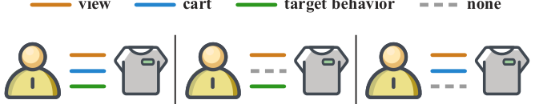
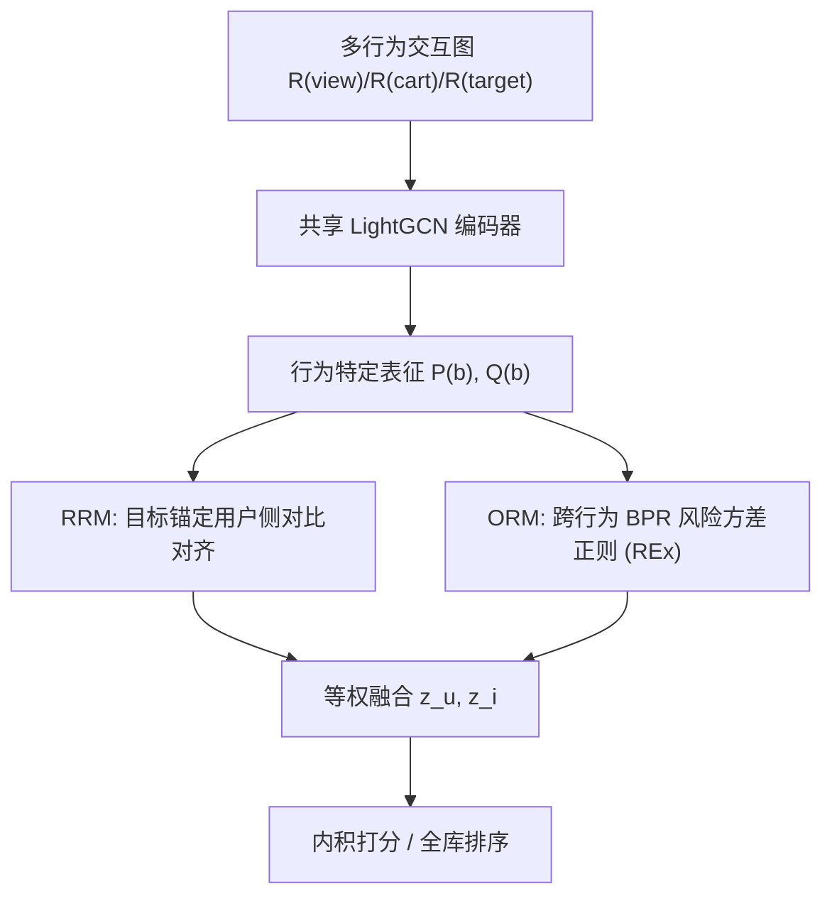
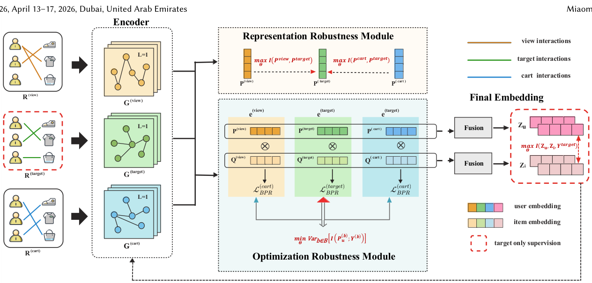

# RMBRec: Robust Multi-Behavior Recommendation towards Target Behaviors (面向目标行为的鲁棒多行为推荐)

- **会议/期刊**: WWW 2026
- **作者与机构**: Miaomiao Cai、Junfeng Fang、Xiang Wang（NUS / USTC）、Zhijie Zhang、Zhiyong Cheng、Meng Wang（合肥工业大学）
- **推荐链路定位**: 召回（多行为图召回）
- **研究方向**: 自监督对比学习与交互去噪 / 图神经网络推荐
- **论文原文**: [https://arxiv.org/abs/2601.08705v3](https://arxiv.org/abs/2601.08705v3)
- **开源代码**: [https://github.com/miaomiao-cai2/RMBRec](https://github.com/miaomiao-cai2/RMBRec)

## TL;DR (1分钟核心速览)

多行为推荐的辅助行为（view/cart/collect）常与购买语义错位甚至相互冲突，朴素融合会把噪声当监督。RMBRec 提出"局部语义一致 + 全局优化不变"的信息论鲁棒框架：RRM 仅在**用户侧**以目标行为为锚做对比对齐（最大化 $I(\mathbf{P}^{(b)}_u;\mathbf{P}^{(t)}_u)$），ORM 以 REx 近似 IRM 惩罚各行为环境 BPR 风险方差。在三个真实数据集、Leave-One-Out + Full-Ranking 协议下，Taobao HR@10 提升 16.3%、NDCG@10 提升 29.5%，且在 50% 边增删扰动下衰减显著小于 UIPL/BCIPM/PKEF。

## Background & Motivation (背景与核心矛盾)

- **主流范式**: 行为特定图编码（LightGCN/CRGCN/MB-CGCN）+ 拼接、MLP 或注意力融合，或将多种行为构造为对比/自监督信号（S-MBRec、MBSSL、MISSL）。
- **前人局限**: ①*分布偏移*——部分用户直接购买、无任何辅助行为，辅助与目标分布天然发散；②*辅助噪声*——随机浏览、弃购车与真实购买意图无关。二者共同造成跨行为语义错位。
- **核心洞察 (Key Insight)**: 作者提出诊断指标 **BAR（Behavioral Alignment Ratio）**，定义为 $BAR(b)=P(b\mid target)=\frac{|\mathcal{R}^{(b)}\cap\mathcal{R}^{(target)}|}{|\mathcal{R}^{(target)}|}$，站在"目标能否被辅助解释"的逆向视角。实测 Beibei 的 view/add-to-cart BAR 高达 0.9756/0.9731（近乎无噪），而 TMall 的 add-to-cart 仅 0.0012、Taobao 为 0.1509——辅助信号可靠性在数据集间差异极大。
- **本文切入点**: 鲁棒性等价于"最大化预测信息、最小化其在异构行为环境间的方差"，故用局部对比 + 全局不变正则两端协同，而非继续设计更复杂的融合结构。

<figure class="paper-figure" markdown="span">
  <figcaption>图1：多行为推荐中分布偏移与辅助噪声的示意图。跨行为的语义错位使异构信号的朴素融合不可靠。</figcaption>
</figure>

## Method (核心方法设计)

### 1. 整体框架 (Overall Architecture)

输入为多张行为交互图 $\{\mathbf{R}^{(b)}\}$，共享 LightGCN 编码器$f(\cdot)$产出行为特定表征$\mathbf{P}^{(b)},\mathbf{Q}^{(b)}=f(\mathbf{R}^{(b)},\mathbf{Z}_u,\mathbf{Z}_i)$，各行为各自计算 BPR 损失。随后 RRM 在用户表征空间把辅助行为锚向目标行为；ORM 把每种行为视为独立"环境"，对各自 BPR 风险做方差收缩。最终等权融合$\mathbf{z}_u=\frac{1}{|\mathcal{B}|}\sum_b\mathbf{p}^{(b)}_u$、$\mathbf{z}_i=\frac{1}{|\mathcal{B}|}\sum_b\mathbf{q}^{(b)}_i$，以内积$s(u,i)=\mathbf{z}_u^\top\mathbf{z}_i$ 做目标行为打分。推理仅需融合后的单塔向量，与 LightGCN 同阶开销。

<figure class="paper-figure" markdown="span">
  <figcaption>图2：RMBRec 的总体框架，通过表示鲁棒性和优化鲁棒性提升鲁棒性。</figcaption>
</figure>

### 2. 关键设计拆解 (Key Designs)

1. **RRM：只对齐用户、且只朝目标对齐**：作者观察到物品属性跨行为基本不变（被浏览或被购买的商品仍是同一件），语义漂移几乎只发生在**用户意图**上。故正样本对为 $(\mathbf{p}^{(b)}_u,\mathbf{p}^{(target)}_u)$，负样本取同 batch 内其它用户在同一辅助行为下的表征，避免全局 memory bank：
$$\mathcal{L}^{(b,u)}_{RRM}=-\log\frac{\exp(\mathrm{sim}(\mathbf{p}^{(b)}_u,\mathbf{p}^{(t)}_u)/\tau)}{\sum_{u'\in\mathcal{N}_u}\exp(\mathrm{sim}(\mathbf{p}^{(b)}_u,\mathbf{p}^{(b)}_{u'})/\tau)}$$
   物理直觉：这是 InfoNCE 对 $I(\mathbf{P}^{(b)}_u;\mathbf{P}^{(t)}_u)$的下界估计，把与购买无关的浏览/收藏意图从用户向量中"挤出"，代价仅为$O(|\mathcal{B}||\mathcal{U}|d)$。

2. **ORM：把行为当作环境，收缩风险方差**：直接优化 IRM 约束 $\nabla_w\mathcal{L}^{(b)}_{BPR}(w\circ h_\phi)=0$不可解，改用 REx 近似——同一预测器$w$ 在各环境上风险应尽量一致：
$$\mathcal{L}_{ORM}=\mathrm{Var}_{b\in\mathcal{B}}\{\mathcal{L}^{(b)}_{BPR}\}=\frac{1}{|\mathcal{B}|}\sum_{b\in\mathcal{B}}\big(\mathcal{L}^{(b)}_{BPR}-\bar{\mathcal{L}}\big)^2$$
   直觉：若模型依赖的是"频繁浏览却不买"这类行为捷径，则各环境风险差异必然拉大；压方差等价于逼迫编码器提取跨行为稳定的因果偏好，且无需显式噪声标签或人工环境构造（区别于 UIPL 用 VAE 合成环境）。

3. **训练目标、负采样与推理效率**：总损失
$$\mathcal{L}=\mathcal{L}_{main}+\lambda_1\mathcal{L}_{RRM}+\lambda_2\mathcal{L}_{ORM}$$
   其中 $\mathcal{L}_{main}$ 只用**目标行为**三元组建 BPR（辅助行为仅通过上述两个正则项间接影响主任务，防止噪声污染主监督）。负采样为每正样本 1 个均匀随机负例 + in-batch 对比负例，免 memory bank、免额外图增广；推理为单次前向 + 全库内积排序。

## Experimental Setup & Evaluation Protocol (实验设置与评估协议)

- **数据集与预处理**（purchase 为目标行为）：

| 数据集 | #Users | #Items | #Interactions | 行为类型 | 密度/BAR 说明 |
| :--- | :---: | :---: | :---: | :--- | :--- |
| Taobao | 48,749 | 39,493 | 2,001,680 | view, cart, purchase | 密度≈0.001，BAR(cart)=0.1509，DT=0.3259 |
| TMall | 41,738 | 11,953 | 2,324,166 | view, cart, collect, purchase | BAR(cart)=0.0012（极低），DT=0.1617 |
| Beibei | 21,716 | 7,977 | 3,359,784 | view, cart, purchase | BAR 均>0.97，近无噪、DT=0.0244 |

- **数据划分与防穿越 (Splitting Strategy)**: 标准 `Leave-One-Out`——每个用户最后一条**目标行为**交互作测试、倒数第二条作验证，其余训练。
- **排名评测协议 (Ranking Protocol)**: 无偏 `Full-Ranking（全库未交互物品排序）`，指标 HR@K / NDCG@K，$K\in\{10,20\}$；5 个随机种子取均值，配对 t 检验$p<0.05$（表中 `*`）。
- **对比基线与超参设置**: 单行为（LightGCN、SimGCL）与多行为（CRGCN、MB-CGCN、PKEF、BCIPM、MISSL、S-MBRec、MBSSL、UIPL）共 10 个基线；LightGCN 作骨干，PyTorch + Adam，$\tau$、$\lambda_1$、$\lambda_2$ 网格搜索。

## Key Experimental Results (实验关键数据)

### 1. 主实验对比 (Main Results)

| 数据集-指标 | LightGCN | SimGCL | CRGCN | PKEF | BCIPM | MBSSL | UIPL | **RMBRec** | Improv. |
| :--- | :---: | :---: | :---: | :---: | :---: | :---: | :---: | :---: | :---: |
| Taobao HR@10 | 0.0253 | 0.0400 | 0.1142 | 0.1098 | 0.1257 | 0.0861 | 0.1225 | **0.1462\*** | +16.3% |
| Taobao NDCG@10 | 0.0137 | 0.0236 | 0.0632 | 0.0627 | 0.0708 | 0.0480 | 0.0748 | **0.0969\*** | +29.5% |
| Taobao HR@20 | 0.0364 | 0.0522 | 0.1477 | 0.1223 | 0.1723 | 0.1247 | 0.1567 | **0.1766\*** | +2.5% |
| TMall HR@10 | 0.0379 | 0.0709 | 0.0840 | 0.1138 | 0.1418 | 0.0760 | 0.1484 | **0.1549\*** | +4.3% |
| TMall NDCG@10 | 0.0205 | 0.0399 | 0.0442 | 0.0642 | 0.0743 | 0.0421 | 0.0819 | **0.0838\*** | +2.3% |
| Beibei HR@10 | 0.0383 | 0.0420 | 0.0539 | 0.0813 | 0.0670 | 0.0626 | 0.0731 | **0.0924\*** | +13.6% |
| Beibei NDCG@10 | 0.0207 | 0.0210 | 0.0259 | 0.0421 | 0.0331 | 0.0352 | 0.0377 | **0.0489\*** | +16.1% |

### 2. 消融实验 (Ablation Study)

| 模型变体 | Taobao HR@10 | Taobao NDCG@10 | TMall HR@10 | TMall NDCG@10 | Beibei HR@10 | Beibei NDCG@10 |
| :--- | :---: | :---: | :---: | :---: | :---: | :---: |
| RMBRec (full) | **0.1462** | **0.0969** | **0.1549** | **0.0838** | **0.0924** | **0.0489** |
| w/o RRM | 0.1089 (−25.5%) | 0.0702 (−27.5%) | 0.1083 (−30.1%) | 0.0589 (−29.7%) | 0.0667 (−27.8%) | 0.0321 (−34.3%) |
| w/o ORM | 0.1321 (−9.6%) | 0.0887 (−8.4%) | 0.1360 (−12.2%) | 0.0766 (−8.6%) | 0.0871 (−5.7%) | 0.0461 (−5.7%) |
| w/o View | 0.1093 (−25.2%) | 0.0758 (−21.7%) | 0.0686 (−55.7%) | 0.0411 (−51.0%) | 0.0789 (−14.6%) | 0.0425 (−12.9%) |
| w/o Add-to-cart | 0.1016 (−30.5%) | 0.0603 (−37.7%) | 0.1895 (**+22.3%**) | 0.1043 (**+24.5%**) | 0.0571 (−38.1%) | 0.0294 (−39.7%) |

### 3. 关键实验发现 (Key Findings)

1. **RRM 是主引擎、ORM 是稳定器**：移除 RRM 使 HR@10 在三个数据集上分别掉 25.5%/30.1%/27.8%，远大于 ORM 的 9.6%/12.2%/5.7%，说明"目标锚定的用户侧对齐"承担了绝大部分去噪收益，而方差正则主要贡献泛化稳定性（在噪声注入实验中体现）。
2. **增益随行为噪声程度呈倒 U 形**：BAR 中等偏低的 Taobao 收益最大（NDCG@10 +29.5%），BAR 极低的 TMall 仅为 +2.3%~+4.3%，说明对齐机制在"部分可用"的辅助信号上最有效，在近乎无关信号上被贴到天花板——这也直接暴露了 RRM 的适用边界。
3. **负面迁移确实存在，等权融合是隐患**：TMall 上 add-to-cart 的 BAR 仅 0.0012，去掉它反而使 HR@10 提升 22.3%，证明等权融合 $\frac{1}{|\mathcal{B}|}\sum_b$ 无法屏蔽强噪声行为，作者在结论中亦承认需引入基于 BAR 的自适应对齐/门控。

## Highlights & Limitations (亮点、对比与审稿批判)

- **与代表作对比 (vs. Prior Work)**: 相较 CRGCN/MB-CGCN/PKEF 的"融合导向"设计，本文不改融合结构、只改监督与优化目标，属正交改进；相较 S-MBRec/MBSSL/MISSL 的对称式跨行为对比（把每个行为都当正信号），RMBRec 的对比是**单向锚定目标**，天然抵抗错位行为；相较 UIPL 用 VAE 人工合成环境，ORM 直接以真实行为作为天然环境，无需生成模型且把不变性从表征层扩展到优化层。
- **可迁移亮点**: ①"物品稳定、用户漂移"的先验可迁移到跨域/多场景推荐的用户表征对齐；② $\mathcal{L}_{ORM}=\mathrm{Var}_b(\mathcal{L}^{(b)})$ 是一个极轻量的多任务/多环境平衡器，可直接替代人工调权的多目标加权。
- **审稿级局限批判**: ①BAR 只做诊断不进入模型，导致 TMall 式低 BAR 行为仍被等权融合、出现明确负迁移，鲁棒性主张在此场景被削弱；②对比负例仅取 in-batch 同行为用户，batch 小或用户数少时负例质量低、方差大；③仅 3 个电商数据集、单一 LightGCN 骨干，未验证对序列/图Transformer骨干的普适性；④ $\lambda_1,\lambda_2$ 呈单峰敏感，跨数据集最优值不一致，落地需重调。

## Rating (四维评分)

- **方法创新性 (Novelty)**: ⭐⭐⭐⭐ （以"物品不变、用户漂移"为先验做单向目标锚定对比，并把行为直接当 IRM 环境用 REx 收方差，组合简洁且信息论解释自洽，但单点算子本身不算全新）
- **评估协议与实验扎实度 (Protocol & Experiments)**: ⭐⭐⭐⭐ （Leave-One-Out + Full-Ranking、10 个强基线、5 种子 + 显著性检验、增删 10/30/50% 边的扰动实验齐全，唯缺线上 A/B 与冷启动分桶）
- **写作与数学规范度 (Clarity & Rigor)**: ⭐⭐⭐⭐ （BAR 定义与 IRM→REx 的近似动机交代清楚，公式量克制；但 §3.3 重复句与附录才给的理论细节削弱了推导完整性）
- **工业落地与复现价值 (Industrial & Practical Value)**: ⭐⭐⭐⭐ （仅两个正则项、无额外图增广与 memory bank，推理与 LightGCN 同构；代码已开源，但 TMall 揭示的负迁移需上线前加行为门控）

