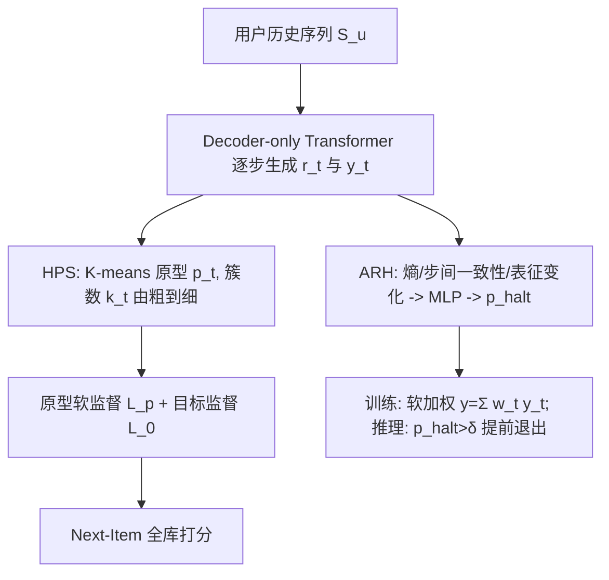
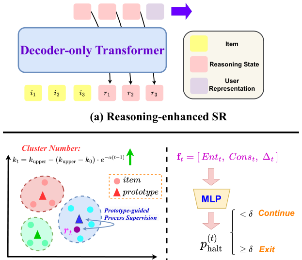
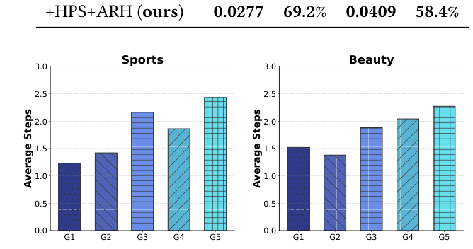

# DTRec: Learning Dynamic Reasoning Trajectories for Sequential Recommendation (为序列推荐学习动态推理轨迹)

- **会议/期刊**: WWW 2026 (Under Review)
- **作者与机构**: Yifan Shao (CUHK), Peilin Zhou (HKUST-GZ), Shoujin Wang (UTS), Weizhi Zhang (UIC), Xu Cai (Jilin Univ.), Sunghun Kim (HKUST)
- **推荐链路定位**: 召回 / Next-Item 全库排序（推理增强的序列建模）
- **研究方向**: 序列与会话推荐 / 大语言模型推荐 (LLM4Rec)
- **论文原文**: [arXiv:2512.14036](https://arxiv.org/abs/2512.14036v1)
- **开源代码**: 暂未开源

## TL;DR (1分钟核心速览)

推理增强序列推荐（ReaRec/LARES）沿用"每步都预测最终 item + 固定推理步数 $T$"的静态轨迹，与"由粗到细"的认知规律错配，并对简单样本过度计算。DTRec 从**方向**与**深度**两轴动态化：HPS 用逐级放大的 K-means 语义原型做步骤感知软监督，ARH 用熵/步间一致性/表征变化三指标经 MLP 决定停机。Amazon Sports/Beauty/Yelp 全库排序下 NDCG@10 相对最强基线最高 +24.5%，推理步数降至 58.4%（省 41.6%）。

## Background & Motivation (背景与核心矛盾)

- **主流范式**: SASRec/BERT4Rec 用 Transformer 直接建模转移；ReaRec/LARES 引入思维链式中间推理序列 $R_u=\{r_1,\dots,r_T\}$，以$P(\hat{i}_{n+1}|R_u,S_u)P(R_u|S_u)$ 先"想"后"答"。
- **前人局限一（方向平）**: 所有中间步都用最终 target 做交叉熵监督，等于把"类目→属性→具体 item"的多级抽象压平成同一粒度，信号过强，推理状态从第 1 步就贴着 target（原文图 2 的 t-SNE 显示 ReaRec 轨迹全程挤在目标附近，陷入局部最优）。
- **前人局限二（深度死）**: 步数对所有样本固定，简单可预测模式被反复过度推理，兴趣突变的复杂序列反而欠推理，算力错配。
- **核心洞察 (Key Insight)**: 推理的**语义粒度**应随步数递增（粗→细），推理的**步数**应由当前收敛状态而非全局常数决定。
- **本文切入点**: 把"轨迹"拆成正交两轴——HPS 管方向、ARH 管深度，且对骨干网络即插即用。

## Method (核心方法设计)

### 1. 整体框架 (Overall Architecture)

用户历史序列 $S_u$送入 decoder-only Transformer，逐位置输出推理状态$r_t$与打分$\hat{y}^{(t)}=\text{softmax}(r_t \mathbf{E}^{\top})$。训练时两路并行：HPS 在 item 嵌入表上做 K-means 得到"当前步粒度"的语义原型$p_t$，用其打分分布软对齐$r_t$的输出分布；ARH 采集三个收敛指标，经轻量 MLP 输出停机概率$p^{(t)}_{\text{halt}}$，把各步预测按"首次停机的概率质量"$w_t$加权融合成最终分布。推理时一旦$p^{(t)}_{\text{halt}}>\delta$ 即硬退出，后续步不再解码，从而省算力。

<figure class="paper-figure" markdown="span">
  <figcaption>图1：我们的 DTRec 框架的整体架构。</figcaption>
</figure>

### 2. 关键设计拆解 (Key Designs)

1. **层次过程监督 HPS（让方向由粗到细）**: 平监督的症结是"每步都要求预测到 item 级"。HPS 令簇数随步指数增长
   $k_t=k_{\text{upper}}-(k_{\text{upper}}-k_0)e^{-\alpha(t-1)},$再按最近邻取原型$p_t=\arg\min_{c_i^{(t)}}\|r_t-c_i^{(t)}\|_2$，用 KL 形式的软目标
   $\mathcal{L}_p=-\sum_{t}\hat{y}_p^{(t)}\log\hat{y}^{(t)}$
   对齐两步分布。直觉：早期簇少（≈类目级），监督宽松只约束"方向大致对"；后期簇多（≈属性/item 级），自然收敛到精确目标，等价于给轨迹一条"由粗到细的语义阶梯"，避免第 1 步就被 target 钉死。
2. **自适应推理停机 ARH（让深度按需伸缩）**: 单一指标（如直接对 $r_t$训二分类停机头 REE）易误判。ARH 融合互补证据：预测熵$Ent_t=-\sum_i\hat{y}^{(t)}_i\log\hat{y}^{(t)}_i$、步间一致性$Con_t=D_{KL}(\hat{y}^{(t-1)}\|\hat{y}^{(t)})$、表征变化$\Delta_t=\|r_t-r_{t-1}\|_2$，拼接后$\;p^{(t)}_{\text{halt}}=\text{MLP}([Ent_t,Con_t,\Delta_t])$。训练用软停机规避离散不可导：$w_t=p^{(t)}_{\text{halt}}\prod_{j<t}(1-p^{(j)}_{\text{halt}})$，$\hat{y}=\sum_t w_t\hat{y}^{(t)}$；推理用阈值$\delta$ 硬退出。软加权本身还是"多步预测集成"，故停机反而可能涨点。
3. **训练目标、负采样与推理效率**: 总损失 $\mathcal{L}=\mathcal{L}_0+\lambda\mathcal{L}_p$，其中$\mathcal{L}_0=-\sum_t\log\hat{y}^{(t)}_{v^\star}$；$\lambda$在$10^{-2}\!\sim\!1$ 间搜索并前 10 epoch 线性 warm-up（防止欠训练嵌入产生噪声原型）；全库 softmax 训练，**无需额外负采样**。推理仅比每步多一次 3 维输入 MLP 前向，平均步数降至基线的 69.2%(Sports)/58.4%(Beauty)。

## Experimental Setup & Evaluation Protocol (实验设置与评估协议)

- **数据集与预处理**: 三个公开数据集，稀疏度 99.93%–99.95%，沿用前作 [8] 的预处理与 5-core 过滤口径。

| 数据集 | #Users | #Items | #Interactions | 稀疏度 | 特征/场景说明 |
| :--- | :---: | :---: | :---: | :---: | :--- |
| Sports | 35,598 | 18,357 | 296,337 | 99.95% | Amazon 运动户外 |
| Beauty | 22,363 | 12,101 | 198,502 | 99.93% | Amazon 美妆 |
| Yelp | 30,499 | 20,068 | 317,182 | 99.95% | 本地生活商户点评 |

- **数据划分与防穿越**: 原文仅述"follow the same preprocessing as previous work"，即业界惯例的 **Leave-One-Out**（末位交互为测试、次末位为验证），未见显式时间戳切分与冷启动划分说明。
- **排名评测协议**: **Full-Ranking 全库未交互物品排序**（无采样候选集、无 1:100 负采样），指标 Recall@{10,20}、NDCG@{10,20}，符合严格评测要求。
- **对比基线与超参**: 骨干 SASRec / GRU4Rec / BERT4Rec，推理类基线 ReaRec、LARES；$k_{\text{upper}}=3000$，$k_0\in[10,100]$，$\alpha\in(0,1)$，$\lambda\in\{10^{-2},10^{-1},1\}$，$\delta\in[0.3,0.8]$；DTRec 各变体均以$p<0.01$ 显著性标记（∗）。嵌入维度原文未明示。

## Key Experimental Results (实验关键数据)

### 1. 主实验对比 (Main Results)

| Backbone | Model | Sports R@10 | Sports N@10 | Beauty R@10 | Beauty N@10 | Yelp R@10 | Yelp N@10 |
| :--- | :--- | :---: | :---: | :---: | :---: | :---: | :---: |
| SASRec | Base | 0.0445 | 0.0212 | 0.0664 | 0.0316 | 0.0605 | 0.0381 |
| GRU4Rec | Base | 0.0342 | 0.0175 | 0.0569 | 0.0281 | 0.0397 | 0.0200 |
| BERT4Rec | Base | 0.0244 | 0.0124 | 0.0394 | 0.0188 | 0.0274 | 0.0136 |
| SASRec | ReaRec | 0.0475 | 0.0224 | 0.0686 | 0.0328 | 0.0621 | 0.0385 |
| SASRec | LARES | 0.0481 | 0.0230 | 0.0707 | 0.0332 | 0.0627 | 0.0390 |
| SASRec | **DTRec** | **0.0553*** | **0.0277*** | **0.0828*** | **0.0409*** | **0.0682*** | **0.0407*** |
| GRU4Rec | **DTRec** | **0.0402*** | **0.0208*** | **0.0677*** | **0.0338*** | **0.0451*** | **0.0232*** |
| BERT4Rec | **DTRec** | **0.0357*** | **0.0173*** | **0.0554*** | **0.0272*** | **0.0406*** | **0.0207*** |

**Improv.**（SASRec 骨干 vs LARES）: N@10 +20.4% / +23.2% / +4.4%；vs 同骨干 SASRec +30.7% / +29.4% / +6.8%；GRU4Rec、BERT4Rec 上 N@10 亦分别相对其 ReaRec/LARES 最优值提升约 +15% 与 +24%，证明即插即用性。

### 2. 消融实验 (Ablation Study)

| 变体 | Sports N@10 | Beauty N@10 | 计算开销 Cons. |
| :--- | :---: | :---: | :---: |
| Base (ReaRec 式平监督+固定步) | 0.0212 | 0.0316 | 100% |
| + HPS（固定簇数 $k$=const） | 0.0248 | 0.0362 | 100% |
| + HPS（去 warm-up） | 0.0258 | 0.0392 | 100% |
| + HPS（完整） | 0.0265 | 0.0398 | 100% |
| + HPS + REE（单指标早停） | 0.0269 | 0.0407 | 85.6% / 67.1% |
| **+ HPS + ARH（DTRec）** | **0.0277** | **0.0409** | **69.2% / 58.4%** |

### 3. 关键实验发现 (Key Findings)

1. **"由粗到细"是真实增益来源而非正则噪声**：固定簇数仅从 0.0212 提到 0.0248，而动态 $k_t$ 再提至 0.0265（相对固定簇数 +6.9%）；去掉 warm-up 掉到 0.0258，说明早期欠训练嵌入生成的原型会污染监督方向。
2. **多指标停机优于单指标，且更省**：ARH 相对 REE 在 Sports 上 N@10 0.0269→0.0277 的同时把开销从 85.6% 压到 69.2%（Beauty 58.4%），即"更准还更快"，印证软加权兼作多步集成、硬退出减少无信息步。
3. **算力分配确实随复杂度流动**：原文图 3 显示平均推理步数随用户交互次数（G1→G5）单调上升，长序列（兴趣更复杂）获得更多步数；同时 ARH 相对固定 $T$ 最多省 41.6% 步数而不损指标。

<figure class="paper-figure" markdown="span">
  <figcaption>图3：不同交互长度水平用户的平均推理步数。G1 表示平均交互次数最低的用户组。</figcaption>
</figure>

## Highlights & Limitations (亮点、对比与审稿批判)

- **与代表作对比**: vs **ReaRec**（逐步监督均为最终 target + 固定 $T$）：DTRec 把"步"变成有粒度的语义台阶并让步数可停；vs **LARES**（潜空间对齐增强推理但步数/监督仍统一）：本文在方向与深度两轴同时解耦，且不改骨干、不做 LLM 蒸馏，成本可控；vs **SASRec/BERT4Rec**：以少量额外解码步换取显式推理，收益在稀疏数据上尤为明显。
- **可迁移亮点**: ①"K-means 原型 + 逐级放大簇数"的软标签方案可迁到生成式推荐的多级语义 ID 生成与扩散/流匹配采样监督；②三指标停机 MLP 可直接用于级联精排/重排的早停与 diffusion 采样步数自适应。
- **审稿级局限批判**: ①只报了**相对步数**（Cons.），未给 wall-clock 延迟、显存与 K-means 重聚类周期，端到端在线开销存疑；②$k_0,\alpha,\lambda,\delta$四组超参强耦合，仅有搜索区间而无敏感度曲线与跨数据集统一配置；③评测仅三个稀疏 Amazon/Yelp 域，划分协议依赖"沿用前作"而未显式声明，且未与需要 prompt 的 LLM-based 推理推荐做成本-效果对照；④停机阈值$\delta$ 全局固定，未做用户级校准或置信区间分析。

## Rating (四维评分)

- **方法创新性 (Novelty)**: ⭐⭐⭐⭐ （把 CoT 推理的"方向/深度"两轴显式解耦，原型粒度指数增长与三指标软停机都是清晰可复用的新算子，但单点技术均属已有思想的组合）
- **评估协议与实验扎实度 (Protocol & Experiments)**: ⭐⭐⭐⭐ （三数据集 Full-Ranking、$p<0.01$ 显著性、三骨干即插即用 + 完整消融，但划分与预处理细节转引前作、缺时延与敏感度实验）
- **写作与数学规范度 (Clarity & Rigor)**: ⭐⭐⭐⭐ （HPS/ARH 公式简洁、软停机推导与训练-推理一致性交代清楚，缺少原型重算频率与复杂度定量分析）
- **工业落地与复现价值 (Industrial & Practical Value)**: ⭐⭐⭐⭐ （模型无关、仅增一个 3 维 MLP 与阈值退出即可省 40% 解码步，落地性强；但闭源且多超参需重调，K-means 离线维护成本未评估）

