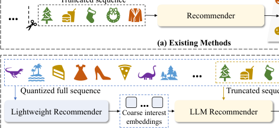
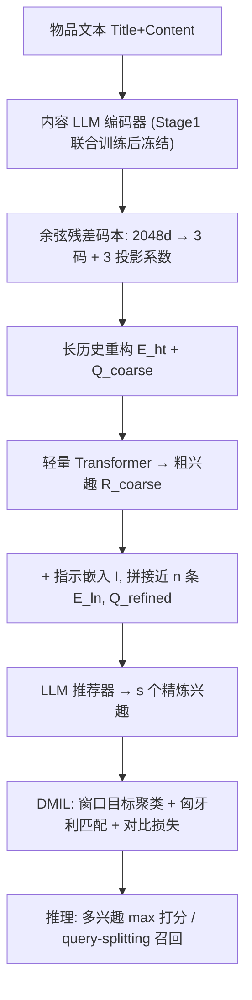
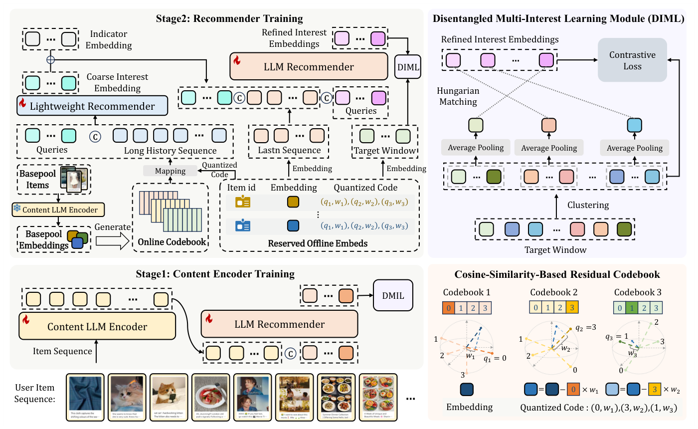

# HyMiRec: A Hybrid Multi-interest Learning Framework for LLM-based Sequential Recommendation (面向 LLM 序列推荐的混合多兴趣学习框架)

- **会议/期刊**: WWW 2026
- **作者与机构**: Jingyi Zhou, Cheng Chen, Kai Zuo, Manjie Xu, Zhendong Fu, Yibo Chen, Xu Tang, Yao Hu（小红书 Inc.；复旦大学；北京大学）
- **推荐链路定位**: 召回（工业系统多路召回中的一路，query-splitting 独立检索）
- **研究方向**: 序列与会话推荐 / 大语言模型推荐
- **论文原文**: [https://arxiv.org/abs/2510.13738v2](https://arxiv.org/abs/2510.13738v2)
- **开源代码**: [https://github.com/FireRedTeam/FireRedSeqRec](https://github.com/FireRedTeam/FireRedSeqRec)

## TL;DR (1分钟核心速览)

针对 LLM 序列推荐的两大痛点——高 QPS 迫使历史序列被截断（长程兴趣丢失）、单 embedding 下一物品预测无法表达多兴趣——HyMiRec 提出两阶段混合框架：先用**余弦相似度残差码本**把 2048 维物品向量压成 3 个码+3 个投影系数（带宽降 300×+），再用**轻量 Transformer 抽粗兴趣、LLM 精炼兴趣**，并以**窗口目标 + 匈牙利匹配的对比损失 (DMIL)** 解耦多兴趣。在 PixelRec / MovieLens-1M 全库排序及 1170 万物品工业集上，较 LLM 基线平均提升 24.53% / 8.9% / 73.71%，线上 A/B 冷启通过率 26.46%→30.93%。

## Background & Motivation (背景与核心矛盾)

- **主流范式**: 一路把 LLM 当特征抽取器（LLMEmb、MoRec）提语义 embedding，另一路把 LLM 当序列推荐器（HLLM、PatchRec）直接做下一物品预测，HLLM 将二者端到端联合。
- **前人局限 1（长序列不可用）**: 线上 QPS 与特征取回带宽限制，LLM 侧只喂最近 10–30 条交互，长程偏好被系统性丢弃；PatchRec 的会话平均池化又造成语义损失与行为断裂。
- **前人局限 2（单兴趣 + 监督失衡）**: ComiRec/Kuaiformer 类多 query 方案仍以单个下一物品为正样本，只有最相似的 query 获得有效梯度，其余 query 欠训练，最终推荐同质化、偏向近期行为。
- **核心洞察 (Key Insight)**: 物品内容 embedding 天然具有聚类与层次结构，可用"少层码本 + 投影残差"近似重构；而短期内用户点击近似可互换，下一物品标签本身噪声大，应把"未来窗口"整体视为正样本集合。
- **本文切入点**: 粗（长历史、轻量）→ 精（近序列、LLM）分层建模，再把窗口内正样本聚类后**一 一匹配**到各兴趣 query，使每个 query 都获得均衡监督。

<figure class="paper-figure" markdown="span">
  <figcaption>图1：我们的方法与现有方法的比较。用户通常具有多种不同兴趣，也包括长期和短期偏好。(a) 现有方法：截断历史序列并使用单一嵌入学习多种兴趣，可能导致长期兴趣遗忘和表示纠缠。(b) 我们的方法：采用混合框架，以多兴趣嵌入对长期和短期行为建模，从而有效学习用户的多种兴趣。</figcaption>
</figure>

## Method (核心方法设计)

### 1. 整体框架 (Overall Architecture)

两阶段训练。**Stage 1**：以 TinyLlama-1.1B 为骨干，内容 LLM 编码器（标题+正文 → 末位 special token 隐状态）与 LLM 推荐器在**短序列**上端到端联合训练；训练后冻结编码器，离线为全库物品算 embedding，并从 basepool 物品上构建 3 层余弦残差码本，把物品压成量化码。**Stage 2**：由量化码在线重构长历史 $E_{ht}$，拼上可学习 query$Q_{coarse}$送入浅层 Transformer 得粗兴趣$R^{u}_{coarse}$；再叠加指示 embedding$I$与最近$n$条真实 embedding$E_{ln}$、精炼 query$Q_{refined}$一起输入 LLM 推荐器，输出$s$个精炼兴趣；最后由 DMIL 用未来窗口目标优化。推理时$s$个兴趣各自检索$K$ 个候选后并集去重再打分，每 10 次新交互刷新一次用户兴趣。

<figure class="paper-figure" markdown="span">
  <figcaption>图2：所提出的 HyMiRec 概览。第1阶段，内容 LLM 编码器与 LLM 推荐器在短序列上联合训练，其中编码器提取物品嵌入，推荐器预测用户兴趣。随后固定训练好的编码器，构建基于余弦相似度的残差码本，并将物品嵌入压缩为量化码。第2阶段，从量化码重建长用户历史，并由带可学习查询的轻量级推荐器处理以产生粗粒度兴趣，再与近期交互结合，并由 LLM 推荐器细化。</figcaption>
</figure>

### 2. 关键设计拆解 (Key Designs)

1. **余弦残差码本 (CSRC，解决带宽瓶颈)**：直接喂原始长历史精度略高但带宽涨 300×，不可上线。对第 $i$层残差做余弦平衡 k-means 得中心$c^i$，取最近中心后**按投影而非直接相减**求残差：

$$b^i_j=\arg\max_{x\in[1,k]}\cos(e^i_j,c^i_x),\quad e^{i+1}_j=e^i_j-\frac{e^i_j\cdot c^i_{b^i_j}}{\lVert c^i_{b^i_j}\rVert^2}\,c^i_{b^i_j}$$

   投影残差保证 $e^{i+1}_j\perp c^i_{b^i_j}$，各层在正交子空间工作、信息不冗余，同时保留沿中心方向的模长使重构更准。重构即$e_{ht}=\sum_{j=1}^{3}\mathcal{C}^j_{q_i}\cdot p_i$，2048 维 → 3 整数 + 3 浮点。余弦（而非欧氏）聚类的理由：训练损失与线上召回都以余弦为准，聚类目标与下游对齐。
2. **粗到精混合推荐器 (解决截断与算力矛盾)**：长历史重复度高、噪声多，全量进 LLM 成本不可接受。轻量 Transformer 只负责"预聚合"出与任务相关的紧凑 $R^{u}_{coarse}=\phi_{Light}([E_{ht},Q_{coarse}])$，其梯度来自与 LLM 推荐器的联合训练；LLM 侧输入为$R^{u}_{refined}=\phi_{LLM}([R_{coarse}+I,\,E_{ln},\,Q_{refined}])$。指示嵌入$I$ 让 LLM 区分"粗兴趣"与"真实近序列"两类语义来源，消融显示去掉后各指标稳定下滑。
3. **DMIL 与训练/推理**：把下一物品换成窗口 $\{t_1,\dots,t_w\}$正样本，先按余弦聚成$s$ 类，再用匈牙利算法做全局最优匹配：

$$\max_{\Pi\in\mathcal{P}_s}\sum_{j=1}^{s}\cos(r_j,g_{\Pi(j)}),\qquad \mathcal{L}_{total}=\frac{1}{w}\sum_{i=1}^{w}\sum_{j=1}^{s}\mathcal{L}_{ctr}(t_i,r_j)\cdot\mathbb{I}[t_i\in G_{\Pi(j)}]$$

   $\mathcal{L}_{ctr}$为温度$\tau$的 InfoNCE，负样本随机采样$m=8$条（非严格 in-batch hard negative）。关键：对比损失**只在匹配到的簇内计算**，避免 query 间互抢梯度；兴趣数$s=2$（公开集）/$3$（工业集），窗口$w=4/8$。窄兴趣用户的多 query 会自然收敛，避免过度切分。推理取$sim_i=\max_{j}\cos(a_i,r_j)$，任一兴趣命中即高分，天然提升多样性。

## Experimental Setup & Evaluation Protocol (实验设置与评估协议)

- **数据集与预处理**（公开集保留交互数 > 60 的用户；工业集随机采样多主题用户）：

| 数据集 | #Users | #Items | #Interactions | 密度 | 平均序列长 / 文本 token |
| :--- | :---: | :---: | :---: | :---: | :--- |
| PixelRec | 148,335 | 98,833 | ≈7.62M | 0.052% | 51.38 / 64.39 |
| MovieLens-1M | 3,938 | 3,677 | ≈0.92M | 6.4% | 234.7 / 15.79 |
| Industrial | 571,958 | 11,708,332 | ≈137.9M | 0.002% | 241.11 / 229.1 |

- **数据划分与防穿越**: 采用**按时间顺序的留出切分**（前缀为历史、目标窗口为未来），长历史与 last-$n$ 严格取自目标窗口之前，无未来交互泄漏。
- **排名评测协议**: 无偏 **Full-Ranking**——PixelRec 与 MovieLens-1M 用全量物品作为候选池；工业集候选池 414,480 个物品（贴近线上真实召回池）。指标 Recall@{10,200}、NDCG@{10,200}（工业集额外报 @50/@100）。
- **对比基线与超参**: ID 类 GRU4Rec / SASRec / HSTU，LLM 类 MoRec / HLLM / PatchRec（后者按本文 setting 重实现为"预测下一物品内容 embedding"）。全部 LLM 方法统一 TinyLlama-1.1B 骨干以保证公平；LLM 类输入长度限 10（公开）/30（工业），ID 类给 100/300。lr=1e-5、Adam + cosine + 0.1 warm-up、batch=16、随机种子 2020；H800 训练。

## Key Experimental Results (实验关键数据)

### 1. 主实验对比 (Main Results)

公开基准（Full-Ranking）：

| 方法 | PixelRec R@10 | R@200 | N@200 | ML-1M R@10 | R@200 | N@200 |
| :--- | :---: | :---: | :---: | :---: | :---: | :---: |
| GRU4Rec | 0.0358 | 0.1646 | 0.0429 | 0.2318 | 0.6846 | 0.2197 |
| SASRec | 0.0427 | 0.2137 | 0.0532 | 0.2580 | 0.7016 | 0.2304 |
| HSTU | 0.0543 | 0.2422 | 0.0631 | 0.2461 | 0.7296 | 0.2263 |
| MoRec | 0.0503 | 0.2241 | 0.5824 | 0.2341 | 0.5863 | 0.2161 |
| HLLM | 0.0583 | 0.2407 | 0.0649 | 0.2715 | 0.6346 | 0.2432 |
| PatchRec | 0.0570 | 0.2417 | 0.0639 | 0.2504 | 0.6302 | 0.2328 |
| **HyMiRec** | **0.0608** | **0.2625** | **0.0691** | **0.2811** | **0.7354** | **0.2474** |
| Improv. vs 最优基线 | +4.29% | +8.38% | +6.47% | +3.54% | +0.79% | +1.73% |

工业数据集（11.7M 物品、候选池 41.4 万）：

| 方法 | R@10 | R@50 | R@200 | N@10 | N@200 |
| :--- | :---: | :---: | :---: | :---: | :---: |
| HSTU | 0.0070 | 0.0237 | 0.0747 | 0.0033 | 0.0133 |
| MoRec | 0.0083 | 0.0267 | 0.0774 | 0.0039 | 0.0152 |
| PatchRec | 0.0128 | 0.0477 | 0.1347 | 0.0067 | 0.0271 |
| HLLM | 0.0163 | 0.0550 | 0.1313 | 0.0085 | 0.0278 |
| **HyMiRec** | **0.0227** | **0.0707** | **0.1577** | **0.0115** | **0.0348** |
| Improv. vs 最优基线 | +39.26% | +28.55% | +17.08% | +35.29% | +25.18% |

### 2. 消融实验 (Ablation Study)

工业集消融（R@10 / R@200 / N@200）：

| 变体 | R@10 | R@200 | N@200 | Δ R@10 |
| :--- | :---: | :---: | :---: | :---: |
| HyMiRec 完整 | 0.0227 | 0.1577 | 0.0348 | — |
| w/o lightweight recommender | 0.0207 | 0.1494 | 0.0326 | −8.81% |
| w/o Indicator Embedding | 0.0220 | 0.1547 | 0.0342 | −3.08% |
| w/o CSRC（原始向量直送） | 0.0233 | 0.1580 | 0.0350 | +2.64%（带宽 ×300+） |
| w/ 欧氏距离残差码本 | 0.0213 | 0.1530 | 0.0338 | −6.17% |
| w/o DMIL（单 query + 单目标） | 0.0193 | 0.1474 | 0.0333 | −14.98% |
| w/o window targets（多 query 单目标） | 0.0173 | 0.1427 | 0.0312 | −23.79% |
| max matching（朴素最近匹配） | 0.0180 | 0.1450 | 0.0324 | −20.70% |

线上 A/B（≥1 周，各 10%~16% 流量对分）：物品冷启日发布量 +0.44%、日活跃发布者 +0.52%；广告冷启通过率（达 500 曝光比例）图文流 26.46%→30.93%、短视频流 13.19%→14.23%。

### 3. 关键实验发现 (Key Findings)

1. **数据越稀疏、物品空间越大，混合架构收益越夸张**：PixelRec 上较 LLM 基线平均 +24.53%，MovieLens 仅 +8.9%，而 1170 万物品的工业集达 +73.71%（R@10 +39.26%）。说明 ID 类方法在超大物品空间失效时，长历史粗兴趣 + LLM 语义精炼的组合才是主要增益来源。
2. **DMIL 是真正的主引擎，窗口目标比多 query 更关键**：去掉 DMIL 掉 14.98%，但保留多 query、仅退回单目标（w/o window targets）反而暴跌 23.79%，甚至劣于单 query——证实了"下一物品单标签导致 query 间梯度失衡"的诊断；改用朴素 max matching 仍掉 20.70%，说明匈牙利全局匹配带来的簇内专属监督不可替代。
3. **码本是效率而非精度工具，且距离度量必须与损失/召回一致**：w/o CSRC 精度仅微升 2.64%，但特征传输带宽涨 300 倍以上；换成欧氏码本则掉 6.17%，因聚类目标与余弦训练损失错位。这种"几乎零损、300× 压缩"的性价比是它能上线的前提。

## Highlights & Limitations (亮点、对比与审稿批判)

- **与代表作对比**: 相比 HLLM（端到端 LLM 双塔，输入仍被截断），HyMiRec 用码本把长历史"折叠进"单个粗兴趣向量，长度突破 LLM 侧 10–30 的硬约束；相比 PatchRec（会话平均池化，语义糊化），本文以可学习 query 注意力聚合而非均值；相比 ComiRec/Kuaiformer（多 query + 单目标），本文用窗口聚类 + 匈牙利匹配解决了 query 欠训练的根本病灶。
- **可迁移亮点**: (1) "投影残差 + 任务同构距离度量"的量化码本可直接用于任何需要压缩用户长行为的召回系统；(2) 匈牙利匹配把 $s$个兴趣 query 与$w$ 个窗口正样本做簇级对齐，这一招可平移到多向量召回、多目标解耦表征等场景。
- **审稿级局限批判**: (1) 兴趣数 $s$与窗口$w$需按数据集调（公开 2/4、工业 3/8），图 3 显示过大即过切分并训练不稳，缺少自适应确定$s$ 的机制；(2) 两阶段训练 + 每 10 次交互刷新兴趣 + 每兴趣独立检索再并集去重，工程管线复杂，论文未给端到端时延/QPS 与 LLM 编码器离线成本对比；(3) 消融只在工业集报告，缺公开集消融与多次运行方差，显著性检验未标注；(4) 码本为静态构建，用户/内容分布漂移下需重建，文中亦自认是 future work。

## Rating (四维评分)

- **方法创新性 (Novelty)**: ⭐⭐⭐⭐ （码本投影残差的正交性设计与"窗口目标+匈牙利簇内匹配"两处算子改造均有明确动机，但整体属混合框架的工程组合创新，缺理论分析）
- **评估协议与实验扎实度 (Protocol & Experiments)**: ⭐⭐⭐⭐ （公开集 Full-Ranking + 1170 万物品工业集 + 双场景线上 A/B 相当完整，但消融仅工业集、无方差与显著性检验）
- **写作与数学规范度 (Clarity & Rigor)**: ⭐⭐⭐⭐ （公式与符号链条清晰、码本重构与匹配损失定义完整，主表个别数值疑似排版错位，超参敏感性仅有曲线无表格）
- **工业落地与复现价值 (Industrial & Practical Value)**: ⭐⭐⭐⭐⭐ （开源代码，300× 带宽压缩 + query-splitting 低侵入改造 + 真实 A/B 冷启收益，是可复现的工业级方案）

