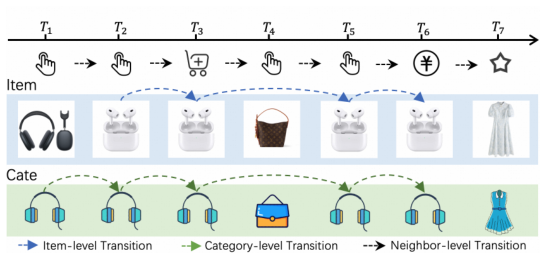
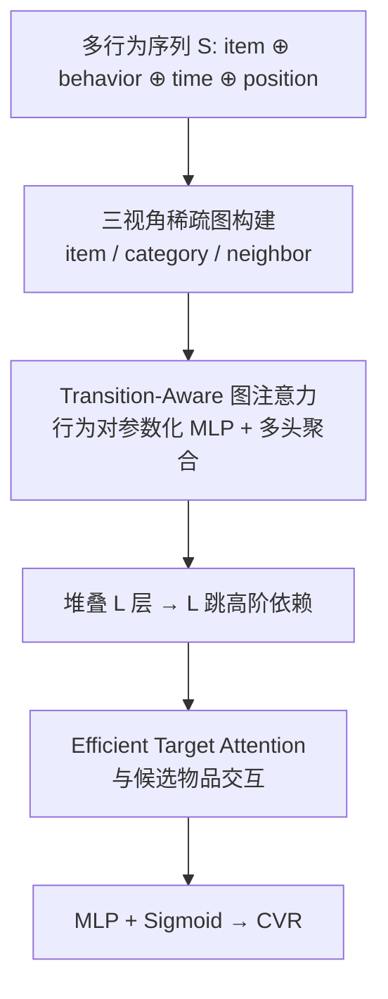
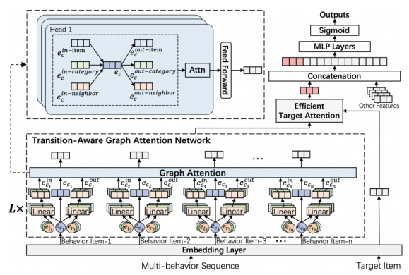

# Multi-Behavior Sequential Modeling with Transition-Aware Graph Attention Network for E-Commerce Recommendation (面向电商推荐的多行为序列建模与转移感知图注意力网络)

- **会议/期刊**: WWW 2026 (Short Paper)
- **作者与机构**: Hanqi Jin, Gaoming Yang, Zhangming Chan, Yapeng Yuan, Longbin Li, Yeqiu Yang, Jian Wu, Yuning Jiang, Bo Zheng (阿里巴巴淘天集团) ; Fei Sun (中国科学院大学)
- **推荐链路定位**: 精排（post-click CVR 预估，序列建模模块）
- **研究方向**: 序列与会话推荐 / 图神经网络与知识图谱推荐
- **论文原文**: [https://arxiv.org/abs/2601.14955v1](https://arxiv.org/abs/2601.14955v1)
- **开源代码**: 暂未开源

## TL;DR (1分钟核心速览)

电商多行为序列建模长期依赖 Transformer，$O(L^2d)$复杂度使其在千级长序列（工业侧人均 1536 条行为）上要么 OOM 要么被迫截断。本文提出 TGA：先用 item/类目/邻居三视角构建**每节点至多一前一后**的稀疏转移图，再用**由行为转移类型参数化**的图注意力做双向聚合，把复杂度降到$O(NLd^2)$。Taobao 数据集 AUC 0.7454（超 END4Rec 0.66%），训练推理较 Transformer 快 5.8 倍；线上 7 天 A/B 的 CVR +1.29%、GMV +1.79%。

## Background & Motivation (背景与核心矛盾)

- **主流范式**: 多行为序列建模分两支——按行为类型切分子序列提取互影响（MB-STR），或用行为知识作为辅助信号增强 item 表征（END4Rec）；长序列效率侧则用 Reformer / Linear Transformer / Longformer 等稀疏或核近似注意力。
- **前人局限**: ① Transformer 类方法把**所有行为对一视同仁**，而 `click→buy` 与 `click→click` 的决策含义截然不同，全连接注意力把强信号淹没在噪声边中；② $O(L^2)$ 成本与工业长序列（1024–1536）不可兼容，稀疏注意力变体又牺牲了局部转移结构的表达力。
- **核心洞察 (Key Insight)**: 真正有信息量的行为转移是**稀疏且结构化**的——高客单价商品触发同一 item 上的反复回访（item 级），同品类内跨 item 比价（类目级），以及时间上紧邻的原始顺序依赖（邻居级）；三者合计平均每节点仅 0.56 / 1.19 / 2.00 条边，远低于全连接。
- **本文切入点**: 用"结构化稀疏图 + 转移类型参数化注意力"替换稠密自注意力，在保持线性复杂度的同时**显式区分转移语义**。

<figure class="paper-figure" markdown="span">
  <figcaption>图1：多行为序列建模中的物品级、类别级和邻居级转移。</figcaption>
</figure>

## Method (核心方法设计)

### 1. 整体框架 (Overall Architecture)

输入为用户画像 $u_p$与多行为序列$\mathcal{S}$（每元素含 item、behavior、timestamp、position 四类 embedding 拼接）。首先把序列转成三视角有向稀疏图；随后堆叠$L$层 Transition-Aware Graph Attention，每层对每个节点在其入边、出边上做"行为对专属 MLP 变换 + 多头注意力聚合"，层数堆叠即扩散到$L$跳高阶依赖；输出的序列表征交由 Efficient Target Attention (ETA) 与候选物品$c$交互，最后与$u_p$、$c$ 一起过 MLP + Sigmoid 输出 CVR。

<figure class="paper-figure" markdown="span">
  <figcaption>图2：我们提出的 TGA 方法的概览。</figcaption>
</figure>

### 2. 关键设计拆解 (Key Designs)

1. **三视角结构化稀疏图（把"该看哪些转移"变成先验）**：痛点是对全连接注意力而言所有边同权且代价平方级。构图规则为：同一 item 上 $b_x\!\to\!b_y$建 item 级边；同品类内$(i_x,b_x)\!\to\!(i_y,b_y)$建类目级边；时间相邻的$(i_x,b_x)\!\to\!(i_{x+1},b_y)$ 建邻居级边。每关系视图内每节点只连**至多一个前驱与一个后继**，把平均度数压到 0.56/1.19/2.00，高阶关系交由层堆叠而非稠密连边表达——这是线性复杂度的根本来源。
2. **转移类型参数化的图注意力（本文最核心 delta）**：普通 GAT 对所有边共享 $W$，无法区分 `click→buy` 与 `favorite→cart`。TGA 让**行为对$(b_l\!\to\!b_c)$ 直接索引一组 MLP 权重与偏置**，并把时间差、位置差显式拼入输入：

$$e^{\text{in}}_{c}=\mathbf{W}^{\text{in}}_{b_l\to b_c}\cdot\big[e_l\oplus e_c\oplus(e^t_c-e^t_l)\oplus(e^p_c-e^p_l)\big]+b^{\text{in}}_{b_l\to b_c}$$

出边同理得到 $e^{\text{out}}_{c}$，六条边（三视图 × 出入）汇成邻居集合$\mathcal{N}(e_c)$后做多头注意力$\hat{e}^{(k)}_c=\sum_{u\in\mathcal{N}(e_c)}\alpha_k(u,e_c)\cdot W^V_k u$，再经残差 + LayerNorm + FFN。直觉上：转移类型参数化等价于给每条边一个"语义专属的线性算子"，而相对时间/位置差刻画了决策节奏（犹豫越久 → 位置差越大），使模型在稀疏图上也能分辨"冲动点击"与"深思熟虑后购买"。
3. **训练目标、负采样与推理效率**：任务是 post-click CVR，样本即"点击是否转化"，故用标准二分类交叉熵 $\mathcal{L}=-\frac{1}{|\mathcal{D}|}\sum_{(u_p,\mathcal{S},c,y)\in\mathcal{D}}\big[y\log\hat{y}+(1-y)\log(1-\hat{y})\big]$，**无需负采样**（负例天然来自未转化点击）。复杂度上，边变换为$O(NLd^2)$、六边注意力为$O(NLd)$，总体对序列长度**线性**，对比 Transformer 的$O(NL^2d)$。

## Experimental Setup & Evaluation Protocol (实验设置与评估协议)

- **数据集与预处理**:

| 数据集 | #Users | #Items | #Interactions | 稀疏度/密度 | 特征/场景说明 |
| :--- | :---: | :---: | :---: | :---: | :--- |
| Taobao (公开) | 原文未披露 | 原文未披露 | 原文未披露 | 原文未披露 | 4 类行为 (click/cart/fav/buy)，序列截断至 256 |
| Industrial (淘宝线上) | 原文未披露 | 原文未披露 | > 10 billion | 原文未披露 | 14 天日志，人均 1536 条行为，取最近 1024 条四行为序列 |

- **数据划分与防穿越**: Taobao 按 **timestep 时序切分** 80%/10%/10%；工业集用 14 天日志训练、**次日日志**为测试集，严格防穿越。
- **排名评测协议**: 本文属 CTR/CVR 预估范式，采用 **AUC**（非 Full-Ranking / Sampled Ranking 的 top-K 指标），并额外报告训练+推理加速比 T&I Speed 作为效率度量。
- **对比基线与超参**: 基线含标准 Transformer、三种高效注意力（Reformer、Linear Transformer、Longformer）与两个 SOTA 多行为模型（MB-STR、END4Rec）；所有模型共享输入特征与主干，仅替换序列建模模块；$d=64$、batch 512、$L=3$；显著性标注为$p<0.05$。

## Key Experimental Results (实验关键数据)

### 1. 主实验对比 (Main Results)

| 模型 | Taobao AUC | T&I Speed | Industrial AUC | T&I Speed |
| :--- | :---: | :---: | :---: | :---: |
| Transformer | 0.7276* | 1.0x | OOM | – |
| MB-STR | 0.7334* | 0.8x | OOM | – |
| END4Rec | 0.7405* | 1.8x | OOM | – |
| Reformer | 0.7306* | 1.7x | 0.8623* | 1.0x |
| Linear Transformer | 0.7348* | 1.9x | 0.8619* | 1.0x |
| Longformer | 0.7244* | 2.1x | 0.8617* | 1.2x |
| **TGA (Ours)** | **0.7454** | **5.8x** | **0.8635** | **3.4x** |
| Improv. | +0.66% (vs. END4Rec) | 3.2x faster | +0.14% (vs. Reformer) | 2.8x faster |

### 2. 消融实验 (Ablation Study)

| 变体 (Industrial) | AUC | Δ |
| :--- | :---: | :---: |
| TGA (full) | **0.8635** | – |
| w/o Item-Level Transitions | 0.8618 | -0.0017 |
| w/o Category-Level Transitions | 0.8614 | -0.0021 |
| w/o Neighbor-Level Transitions | 0.8625 | -0.0010 |

### 3. 关键实验发现 (Key Findings)

1. **效率是硬门槛而非锦上添花**：工业长序列（1024）上 Transformer、MB-STR、END4Rec 三个强基线**直接 OOM**，只有线性复杂度的 TGA 与三种高效注意力可跑；TGA 不仅在可用集合中 AUC 最高（0.8635 vs 0.8623），且训练推理再快 2.8–3.4 倍——"能不能上线"先于"高几个千分点"。
2. **类目级与 item 级转移是主信号，邻居级是底座**：移除类目级边掉点最多（-0.0021），item 级次之（-0.0017），纯时序的邻居级仅 -0.0010。说明在 CVR 场景里"同品类比价"与"同商品反复回访"承载了决策信息，而原始时间相邻边只是必要但弱的骨架——这与"决策序列 ≠ 浏览序列"的直觉一致。
3. **深层堆叠持续增益，验证"稀疏图 + 多层"可替代稠密注意力**：随 $L$增加 AUC 单调上升（图 3），说明单层一跳的稀疏连边并不损失表达力，$L$层即可覆盖$L$ 跳邻域；线上 7 天、10% 流量 A/B 得到 CVR +1.29%、GMV +1.79%，将离线千分位提升兑现为可观测营收。

## Highlights & Limitations (亮点、对比与审稿批判)

- **与代表作对比 (vs. Prior Work)**: 相较 MB-STR（行为分子序列 + 跨序列互影响）与 END4Rec（行为作为辅助知识增强 item 表征），TGA 的差异在于**把"转移"作为一等公民**：不是按行为切分后拼接，也不是当作 side info，而是用行为对索引的 MLP 权重让每种转移拥有独立算子；相较 Reformer/Longformer 这类"通用稀疏注意力"，TGA 的稀疏性来自电商领域先验（item/类目/邻居），因此同等效率下精度更高。
- **可迁移亮点**: ① "**转移类型 → 参数化 MLP 权重**"的 conditional 算子可直接迁移到跨域/多场景序列（如场景对 → 权重）；② "**每视图仅保留一前一后**"的极简构图 + 层堆叠扩散，是一套可复用的长序列降复杂度模板。
- **审稿级局限批判**: ① 评测仅用 AUC，未给出 GAUC 或 top-K 排序指标，且公开集（Taobao）数据统计未披露、工业集不可复现，横向公平性存疑；② 三视图构图对 item 冷启或类目粒度粗的商品（如跨类目连带购买）会退化为纯邻居级边，且每视图"仅一前一后"的硬截断在强周期性复购场景可能丢边；③ 行为对数量为 $|\mathcal{B}|^2$，四行为尚可（16 组），若行为类型扩到十级则参数与稀疏更新成本线性膨胀，论文未讨论该扩展性。

## Rating (四维评分)

- **方法创新性 (Novelty)**: ⭐⭐⭐⭐ （把"行为对"提升为图注意力的参数化条件，配合三视角稀疏构图，思路简洁但增量明确、工程味足）
- **评估协议与实验扎实度 (Protocol & Experiments)**: ⭐⭐⭐⭐ （公开集 + 十亿级工业集 + 7 天线上 A/B 三级验证，消融完整；扣分在仅有 AUC、数据统计与显著性细节披露不足）
- **写作与数学规范度 (Clarity & Rigor)**: ⭐⭐⭐⭐ （公式与复杂度分析清晰，$O(NLd^2)$推导到位；但损失函数、ETA 模块与图构建细节被压缩进短文，符号$\oplus$ 维度说明略含混）
- **工业落地与复现价值 (Industrial & Practical Value)**: ⭐⭐⭐⭐⭐ （已在淘宝全量部署、5.8x 加速与 CVR/GMV 双涨，是罕见的"效率—效果—营收"三重闭环；唯代码未开源）

