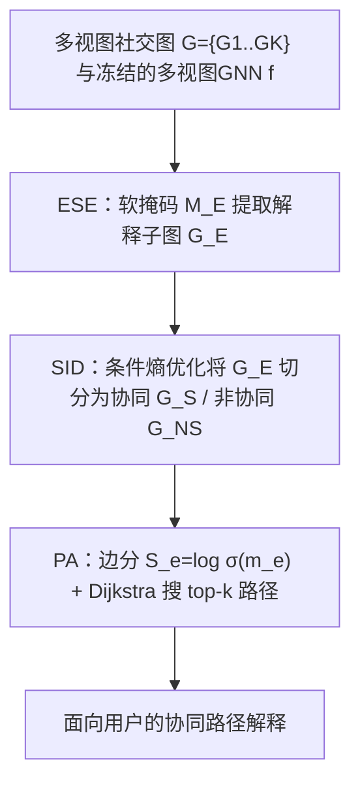
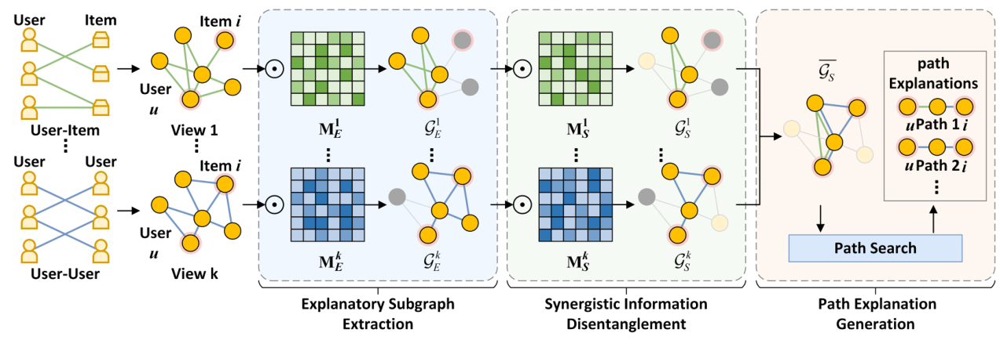

# Explaining Synergistic Effects in Social Recommendations (社交推荐中协同效应的解释)

- **会议/期刊**: WWW 2026
- **作者与机构**: Yicong Li, Shan Jin, Qi Liu, Shuo Wang, Jiaying Liu, Shuo Yu, Qiang Zhang, Kuanjiu Zhou (大连理工大学); Feng Xia (RMIT University)
- **推荐链路定位**: 事后解释模块（独立于召回/精排模型，冻结推荐器后做实例级归因）
- **研究方向**: 社交与群组推荐 / 图神经网络与知识图谱推荐
- **论文原文**: [https://arxiv.org/abs/2601.18151v1](https://arxiv.org/abs/2601.18151v1)
- **开源代码**: [https://github.com/yushuowiki/SemExplainer](https://github.com/yushuowiki/SemExplainer)

## TL;DR (1分钟核心速览)

社交推荐的多视图 GNN 之所以强，源于「好友关系 × 收听行为 × 流派属性」等视图间的**协同效应**，但它天然黑箱，现有解释器只会抽取"重要子图/重要路径"，把各视图贡献当作独立可加，无法回答"哪些信息是被**协同**使用的"。本文把协同效应形式化为图互信息增益 $I(y;G_S)> \sum_k I(y;G_S^k)$，证明单一不等式即可替代$K$ 个视图约束，并将其等价改写为**条件熵最小化**，用一个软掩码即可端到端抽取协同子图。ACM / Last-FM / AugCitation 上协同交互分 SIS 分别达 87.78% / 69.41% / 96.40%，相对最优基线最高 +71.0%。

## Background & Motivation (背景与核心矛盾)

- **主流范式**: 可解释社交推荐分两支——GNN-generic（GNNExplainer / PGExplainer / MAGE / GraphSHAP-IQ 的掩码或 Shapley 子图抽取）与 system-specific（PaGE-Link、xPath、CaGE、SR-GCA 的因果/反事实路径）。
- **前人局限**: ①所有方法对各视图**逐一独立优化**，隐含"多视图贡献可加"假设，抽取出的高重要性特征未必与其他特征发生协同，因此无法解释"为何多视图联合优于单视图之和"；②沿重要性/因果梯度搜索只能给出**归因符号为正**的子图，缺少"某一视图在已知另一视图后互信息是否**上升**"的判据。
- **核心洞察 (Key Insight)**: 协同效应的本质是**信息增益**——已知 $e_2$后$e_1$对$y$ 的互信息变大。作者将其从特征对扩展到图，提出"协同子图"理论：协同信息是解释子图的一个**稀疏子集**，可用"整体互信息是否超过各视图互信息之和"来判定。
- **本文切入点**: 用一个全局不等式约束替代 $K$ 个视图约束，把不可解的多重互信息约束转为**条件熵交叉熵损失**，再用掩码优化直接求解。

## Method (核心方法设计)

### 1. 整体框架 (Overall Architecture)

SemExplainer 是一个**与推荐模型解耦**的三阶段事后解释器，全程冻结多视图 GNN $f(\cdot)$的参数，只优化掩码。阶段一（ESE）对每个视图学习软掩码$\mathbf{M}_E$，从原始多视图图中筛出影响推荐预测的解释子图$G_E$；阶段二（SID）在$G_E$之上再学一个软掩码$\mathbf{M}_S$，把$G_E$切分为协同子图$G_S$与非协同子图$G_{NS}$，通过最大化"整体互信息减各视图互信息之和"实现信息解耦；阶段三（PA）以$\mathbf{M}_E\odot\mathbf{M}_S$定义边协同分，在合并后的异构图上用 Dijkstra 搜索 top-$k$ 条高分路径作为人类可读解释。

<figure class="paper-figure" markdown="span">
  <figcaption>图 2：SemExplainer 的整体结构。</figcaption>
</figure>

### 2. 关键设计拆解 (Key Designs)

1. **协同子图理论：把"多重约束"压成"单一不等式"**：原始定义要求逐视图检验 $I(y;G_S^k \mid G_S^{\backslash k})>I(y;G_S^k)$，需同时优化$K$ 个约束，不可解。作者证明 **Lemma 1**：只要满足
$$I(y;G_S)>\sum_{k=1}^{K}I(y;G_S^k)$$
则任一 $G_S^k$自动满足上式（因$I(y;G_S^k)+I(y;G_S^{\backslash k})\le\sum_k I(y;G_S^k)$，无论视图独立与否均成立）。直觉上，这是把"协同"定义为**整体增益超过各视图边际增益之和**，多出来的部分才是真正的协同信息。

2. **条件熵改写：互信息目标变成可直接跑交叉熵的损失**：由 **Lemma 2**，
$$\arg\max_{\mathbf{M}}\Big[I(y;G_S)-\sum_{k}I(y;G_S^k)\Big]\;\Longleftrightarrow\;\arg\min_{\mathbf{M}}\Big[H(y|G_S)-\sum_{k}H(y|G_S^k)\Big]$$
于是只需把推荐预测的交叉熵 $l(y,\cdot)$ 当作熵的估计量，即可用现成训练流程优化掩码，无需任何互信息估计器。对应三项损失：
$$\mathcal{L}_S=l(y,y_S)-\sum_{k=1}^{K}l(y,y_S^k),\qquad \mathcal{L}_{NS}=\sum_{k=1}^{K}l(y,y_{NS}^k)-l(y,y_{NS})$$
其中 $G_S^k=\mathbf{M}_S^k\odot\mathbf{M}_E^k\odot A^k$、$G_{NS}^k=(1-\mathbf{M}_S^k)\odot\mathbf{M}_E^k\odot A^k$，$\mathcal{L}_{NS}$与$\mathcal{L}_S$ **符号相反**，从而迫使逆掩码只保留非协同信息，实现"协同 / 非协同"互斥解耦。

3. **路径生成、总目标与推理开销**：ESE 阶段用 $\mathcal{L}_E=l(y,y_E)+\lambda\,\sigma\big(\sum_k\|\mathbf{M}_E^k\|_1\big)$，软掩码按$\mathcal{N}(\mu=1.0,\sigma^2=2/n)$初始化以缓解分布漂移，$\lambda$控稀疏度。总损失$\mathcal{L}_{ALL}=\mathcal{L}_E+\mathcal{L}_S+\mathcal{L}_{NS}$。路径侧定义边协同分$S_e=\log\sigma(m_e)$（$m_e\in\mathbf{M}_E\odot\mathbf{M}_S$）、路径得分$S_P=\sum_{e\in P}S_e$，Dijkstra 取 top-$k$。**注意推理代价**：解释是逐实例优化的（每测试样本单独跑 100 epochs），开销高于一次性前向的基线。

## Experimental Setup & Evaluation Protocol (实验设置与评估协议)

- **数据集与预处理**: 三个多视图社交/学术网络，每类关系视为独立视图；无 5-core 过滤描述。

| 数据集 | #实体类型 | #关系类型 | #实体数 | #关系数 | 场景说明 |
| :--- | :---: | :---: | :---: | :---: | :--- |
| ACM | 3 | 2 | 11,246 | 23,664 | paper–author、paper–subject，任务为给作者推荐论文 |
| Last-FM | 2 | 3 | 31,469 | 475,410 | like / friend / belongs-to，任务为给用户推荐音乐人 |
| AugCitation | 5 | 4 | 439,457 | 1,002,845 | paper–tag/author/conference/reference + 额外 author–paper 偏好边 |

- **数据划分与防穿越 (Splitting Strategy)**: **无常规 train/test 划分**。作为实例级解释器，一次优化只生成一个测试实例的解释，故作者不使用划分，而是**随机抽样测试样本**输入解释器；被测推荐模型参数全程冻结、不被访问或修改。
- **排名评测协议 (Ranking Protocol)**: 不做 Top-N 全库排序或采样排序，改用解释学专用四指标：FID+（解释子图复现原预测的比例）、FID−（其补集复现原预测的比例，越低越好）、**SIS**（$\mathbb{E}[\mathbb{I}(I(y,G_S)>\sum_k I(y,G_S^k))]$）、**SIN**（非协同子图的同类比例，越低越好），外加稀疏度 SPA。为公平起见，基线的解释子图被**随机二分**为"协同/非协同"两部分再算 SIS/SIN。
- **对比基线与超参设置**: 9 个基线分两类（GNN-generic：GNNExplainer、PGExplainer、AxiomLayeredge、MAGE、GraphSHAP-IQ；system-specific：PaGE-Link、xPath、SR-GCA、CaGE）。默认 $\lambda=0.1$，掩码优化 100 epochs，双 A100，每组实验重复 4 次报均值±方差。

## Key Experimental Results (实验关键数据)

### 1. 主实验对比 (Main Results)

| 类别 | 方法 | ACM FID+↑ | ACM FID−↓ | ACM SIS↑ | ACM SIN↓ | Last-FM FID+↑ | Last-FM FID−↓ | Last-FM SIS↑ | Last-FM SIN↓ |
| :--- | :--- | :---: | :---: | :---: | :---: | :---: | :---: | :---: | :---: |
| GNN-generic | GNNExplainer | 94.11 | 62.18 | 32.77 | 70.59 | 81.10 | 51.00 | 65.33 | 64.52 |
| | MAGE | 93.98 | 30.36 | 48.12 | 44.87 | 82.71 | 52.70 | 52.90 | 49.57 |
| | GraphSHAP-IQ | **94.20** | 40.22 | 51.34 | 49.22 | 76.29 | 42.12 | 44.71 | 64.86 |
| system-specific | PaGE-Link | 87.92 | 67.13 | 40.65 | 54.23 | 86.53 | 28.20 | 35.85 | 79.65 |
| | xPath | 91.11 | 50.19 | 42.45 | 54.25 | 80.71 | 28.01 | 43.77 | 44.59 |
| | SR-GCA | 90.33 | 52.23 | 47.66 | 65.11 | 90.02 | 29.35 | 47.12 | 49.37 |
| | CaGE | 91.49 | 68.64 | 27.79 | 78.52 | 90.38 | 27.85 | 35.95 | 79.78 |
| **Ours** | **SemExplainer** | 91.81 | **24.55** | **87.78** | **14.03** | **90.41** | **18.13** | **69.41** | **40.87** |
| | *Improv.%* | −2.5% | *−19.1%* | *+71.0%* | *−68.7%* | +0.03% | *−34.9%* | *+6.2%* | *−8.3%* |

AugCitation 上基线 SIS/SIN 依次为：GNNExplainer 53.11 / 49.71、MAGE 49.71 / 48.83、GraphSHAP-IQ 32.10 / 57.13、xPath 60.33 / 54.12、SR-GCA 61.24 / 53.72、CaGE 34.10 / 68.09；**SemExplainer 96.40 / 10.07**（SIS *+57.4%*，SIN *−79.4%*），FID+ 71.56、FID− 10.99 亦为最优。

### 2. 消融实验 (Ablation Study)

原文仅以图 3 呈现消融，未给数值表，趋势如下：

| 变体 | FID+ / FID− | SIS / SIN | SPA | 归因 |
| :--- | :---: | :---: | :---: | :--- |
| w/o ESE | ↓ / ↑ | ↓ / ↑ | ↓ | 失去解释子图这一粗粒度协同筛选，非协同子图混入与预测无关的噪声 |
| w/o SID | ≈ / ≈ | **↓↓ / ↑↑** | ↓ | 保护度尚可但完全丧失协同判别力，说明 SID 是 SIS/SIN 的唯一来源 |
| Full | 最优 | 最优 | 高 | 两模块互补：ESE 负责保真，SID 负责协同解耦 |

### 3. 关键实验发现 (Key Findings)

1. **协同判别力而非保真度才是瓶颈**：各方法 FID+ 被"锁"在 90%–94% 区间（ACM：94.20 vs 91.81，本文甚至略低），但 SIS 从 51.34 跳到 87.78（+71.0%）。这说明既有基线早就能找回"重要子图"，缺的是把子图里的协同部分**分离**出来的机制，Lemma 1 的单约束改写正是这一刀。
2. **协同增益不随视图数单调增长**：视图数 2/3/4 的 ACM / Last-FM / AugCitation 对应 SIS 87.78 / 69.41 / 96.40。Last-FM 虽比 ACM 多一个视图，SIS 反而最低（且相对 GNNExplainer 仅 +6.2%），说明 `friend`/`like`/`belongs-to` 三类边语义高度重叠、信息冗余高，边际信息增益被抵消；而 AugCitation 的异质视图（tag/conference/reference）互补性最强，SIS 逼近 96.40。
3. **稀疏代价极小、路径解释几乎"免费"**：SPA 上 SemExplainer-GE / -GS / -PA 分别为 98.72 / 99.02 / **99.78**（ACM）、98.70 / 98.81 / **99.02**（Last-FM）、98.44 / 98.61 / **98.67**（AugCitation），路径化仅多损失 0.2–1.0 个百分点稀疏度就换来可读解释；耗时上 100 epochs 时 SemExplainer 为 11.18s / 14.98s / 15.61s，与 CaGE（13.19 / 15.73 / 15.92）相当甚至更低，且运行时增长率 $\Delta_{gr}$ 随 epochs 递减（0.619 / 0.477 / 0.412），扩展性良好。

## Highlights & Limitations (亮点、对比与审稿批判)

- **与代表作对比 (vs. Prior Work)**: GNNExplainer / PGExplainer 用掩码做**单视图重要性**筛选，天然假设视图贡献可加；GraphSHAP-IQ 用 Shapley 量化节点交互贡献，但仍给出可加分解而非"增益符号"；CaGE / xPath / SR-GCA 走因果或启发式路径，缺少"协同是否存在"的信息论判据。本文是第一篇把协同效应**定义为不等式约束并转成可训练损失**的工作。
- **可迁移亮点**: ①**Lemma 1 的"多重约束 → 单一全局不等式"降维技巧**可直接搬到多场景/多任务推荐（STAR、PLE 场景归因）与多模态融合归因；②用交叉熵差值 $\sum_k l(y,\cdot)-l(y,\cdot)$ 近似互信息差，是一种零额外估计器的通用解耦手段。
- **审稿级局限批判**: ①**逐实例优化**（每样本 100 epochs）使解释延迟远高于一次性前向的解释器，无法线上实时解释，且作者自陈仅支持 instance-level、缺全局可解释性；②评测协议偏弱——无 train/test 划分、随机抽样本，且对基线强行随机二分解释子图再算 SIS/SIN，可能低估或高估基线的协同判别力；③$\lambda$敏感性明显（图 4 显示$\lambda$增大时 FID+/SIS 下滑），仅靠单点$\lambda=0.1$ 的调参结论说服力有限。

## Rating (四维评分)

- **方法创新性 (Novelty)**: ⭐⭐⭐⭐ （协同子图理论与 Lemma 1/2 的"互信息 → 条件熵"推导扎实，但本质仍是掩码式事后解释框架的巧妙改造）
- **评估协议与实验扎实度 (Protocol & Experiments)**: ⭐⭐⭐ （三数据集九个基线覆盖充分、重复四次报方差，但无划分、无显著性检验、消融仅给曲线不给数值，SIS/SIN 对基线的随机二分处理存在公平性争议）
- **写作与数学规范度 (Clarity & Rigor)**: ⭐⭐⭐⭐ （定义—引理—证明链条完整，Lemma 1 分独立/非独立两情形讨论；但 SIS 定义式与正文互信息符号存在前后不一致，Appendix 承担了过多关键讨论）
- **工业落地与复现价值 (Industrial & Practical Value)**: ⭐⭐⭐ （代码已开源、与推荐模型完全解耦易于挂载，但实例级优化开销与缺少全局解释限制了真实社交平台的部署场景）

